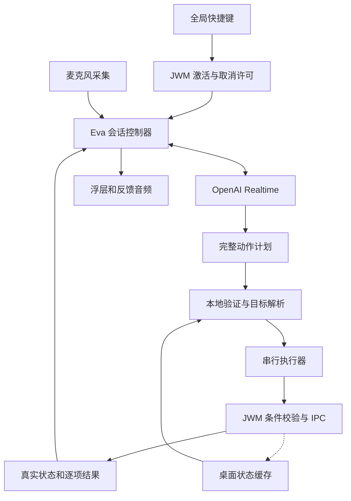
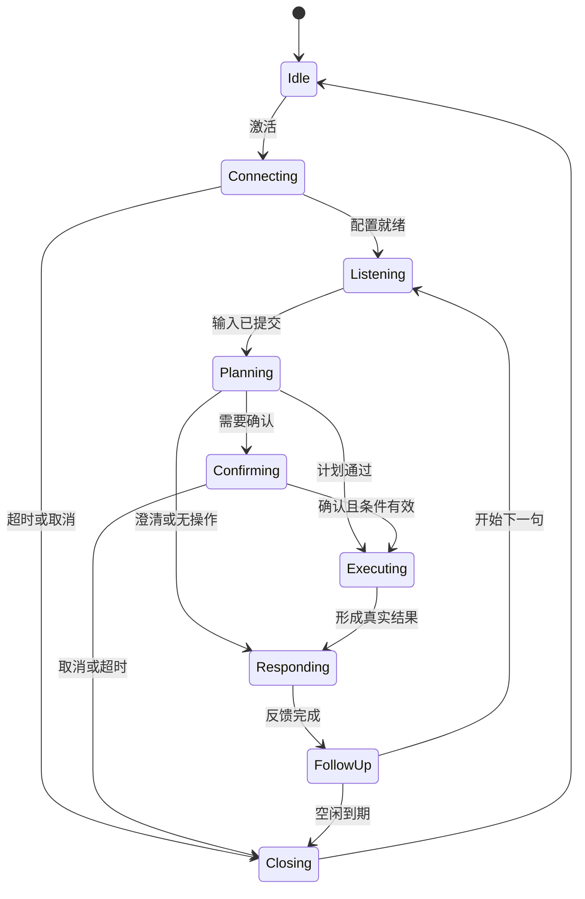

# JWM Eva 语音助手详细设计方案

## 1 设计基线

Eva 是 JWM 的原生语音控制助手。用户通过全局快捷键启动一个短语音会话，以中文或中英混合表达桌面操作，由云端模型生成动作计划，本地服务解析目标、执行 JWM IPC 并核验结果。

**首版采用快捷键激活、独立 Rust 服务和 OpenAI Realtime；待机释放麦克风。后续“hi eva”复用同一会话入口。**

| 项目 | 基线 |
|---|---|
| 设计版本 | 1.0 |
| 日期 | 2026 年 10 月 29 日，北京时间 |
| 实施状态 | 待实施的工程规格 |
| 服务名称 | `jwm-eva` |
| 目标仓库 | `beamiter/jwm` |
| 源码基线 | `91136b8d84143b01748a825d82d176af2ea34429` |
| 首版激活方式 | 可配置全局快捷键，建议候选为 Alt+Ctrl+E |
| 首选云端模型 | `gpt-realtime-2.1-mini` |
| 模型接入 | Realtime API，WebSocket |
| 本地关键词唤醒 | 首版关闭，后续关键词为“hi eva” |
| 默认音频交互 | 半双工，播报期间停止采集；快捷键可立即退出 |
| 最终覆盖目标 | 所有发现的 IPC 名称均完成登记；所有面向用户的规范能力完成语义适配和验收 |

正文中“现有”指上述源码基线的能力；“新增”指本设计要求实现的能力。示例中的 Eva 命令、配置节、上下文令牌和受条件保护的执行接口均属于新增契约，不能直接当成当前 JWM 的可用接口。

### 交互设计基线

用户已确定首版使用快捷键、暂不实现本地唤醒词。其余交互初值由本方案建议：按一次快捷键开始听取，句子结束后自动处理；反馈结束后保留 5 秒继续说话窗口。在窗口内开始说话则进入下一轮，不能在半句话中因空闲计时器到期而关闭麦克风。再次按快捷键或按 Esc 退出会话并阻止后续动作。

后台进程可以常驻。处于 Idle 时，不持有音频采集设备、不发送音频，也不运行本地唤醒检测。

### 功能范围

首个可用版本覆盖切换 tag、修改布局、窗口聚焦和移动、显示器选择、媒体控制、状态查询、取消和错误反馈。后续里程碑按同一动作注册表扩展到全部用户可操作的 IPC。

应用内部的网页填表、邮件发送、任意终端脚本，以及语音身份认证属于另外的能力域。将来可通过 jagent 扩展，但不作为桌面 IPC 执行器的隐式能力。

## 2 现有 JWM 能力与必须补齐的接口

### 已确认的协议基础

现有传输为本地 Unix stream socket，消息为逐行 JSON。默认端点是 `$XDG_RUNTIME_DIR/jwm-ipc.sock`，特定环境下回退到用户专属临时目录。命令、查询、订阅使用不同消息判别字段，响应包含 `success`、可选 `data` 与 `error`；订阅事件包含 `event` 和 `payload`。[S1](https://github.com/beamiter/jwm/blob/91136b8d84143b01748a825d82d176af2ea34429/src/ipc.rs)[S3](https://github.com/beamiter/jwm/blob/91136b8d84143b01748a825d82d176af2ea34429/bridge/src/jwm_ipc.rs)[S4](https://github.com/beamiter/jwm/blob/91136b8d84143b01748a825d82d176af2ea34429/src/ipc_server.rs)

| 注册项目 | 数量 | 统计口径 |
|---|---:|---|
| dispatch command 名称 | 188 | 含别名 |
| special command 名称 | 29 | 含别名 |
| 去重 command 名称合计 | 217 | 不等于 217 种独立用户动作 |
| 去重 query 名称 | 145 | 含别名 |
| dispatch handler 分组 | 94 | 按源码同一匹配分支分组 |
| query handler 分组 | 56 | 按源码同一匹配分支分组 |
| subscription topic | 22 | 含通配符 `*` |

这些数量来自固定版本的注册表，完整名称见附录。运行时始终重新查询 `get_capabilities`，不能把文档中的数量写死为兼容条件。[S1](https://github.com/beamiter/jwm/blob/91136b8d84143b01748a825d82d176af2ea34429/src/ipc.rs)

### 可复用与需新增的部分

| 领域 | 现有能力 | 本设计新增内容 |
|---|---|---|
| 能力发现 | `get_capabilities` 返回名字列表 | 每条规范动作的参数、语义、条件、完成与撤销元数据 |
| 桌面上下文 | 窗口、工作区、显示器、布局查询与订阅 | 同一处理回合生成的执行上下文，以及窗口实例令牌 |
| IPC client | command、query、独立订阅和重连 | 提炼为共用客户端，增加 Eva 执行结果类型 |
| 多步操作 | `command_batch` 顺序执行 | 步骤依赖、逐步核验、部分失败和补偿 |
| 执行一致性 | 多项旧动作依赖当前焦点 | 在 JWM 主循环内校验条件并派发的 `guarded_execute` |
| 关联与去重 | 旧协议没有服务端执行去重契约 | 操作 ID、请求摘要、实例范围内的去重和状态查询 |
| 快捷键 | 已有配置和按键重复控制 | 原生 Eva 激活入口、会话期 Esc 路由、执行许可与租约 |
| 状态显示 | 固定类型的短时 OSD、通知 | 有独立生命周期的 Eva 浮层 |
| 语音 | 无本设计要求的完整服务 | 音频会话、Realtime provider、计划验证器和执行器 |

现有 `command_batch` 默认遇错停止，但不会自动回滚。现有 `success:true` 的完成含义也因命令而异，可能表示已接受、已排队或处理函数返回；必须为每项动作定义核验方式。[S2](https://github.com/beamiter/jwm/blob/91136b8d84143b01748a825d82d176af2ea34429/src/jwm/ipc_handler.rs)

现有事件不带统一 revision；订阅与多个查询组合起来不能自动构成一致快照。状态缓存用于理解和显示，执行时仍需要服务端校验。[S1](https://github.com/beamiter/jwm/blob/91136b8d84143b01748a825d82d176af2ea34429/src/ipc.rs)

## 3 总体架构

`jwm-eva` 是独立的用户进程。音频、TLS、WebSocket、模型响应和日志均由它管理；JWM 主循环只处理有界的本地控制消息、同步条件检查和桌面状态变更。



### 模块职责

| 模块 | 唯一职责 |
|---|---|
| Trigger | 把快捷键或未来唤醒词送入 JWM 的统一激活与取消入口 |
| SessionCoordinator | 持有状态机、代次和截止时间，管理本地执行准入并持有 JWM 签发的有效许可 |
| AudioEngine | 采集、重采样、有界缓冲、播放与实际播放进度 |
| RealtimeProvider | 连接、事件解码、响应关联、取消和用量提取 |
| ContextStore | 保存桌面观测、短期对象引用和已验证结果 |
| ActionRegistry | 定义规范动作、别名、Schema、策略及能力依赖 |
| PlanValidator | 校验完整模型输出，冻结可执行计划 |
| PolicyEngine | 决定直接执行、澄清、确认或拒绝 |
| Executor | 顺序派发、核验、处理部分成功，维护动作账本 |
| OverlayBridge | 发布状态、保持会话租约和处理本地交互 |
| UsageMeter | 按响应去重计费，管理预算准入 |

音频回调、WebSocket 接收任务、IPC 任务只能向会话控制器提交带标识的事件。它们不能自行调用下一条桌面命令。

### 单实例和单执行计划

每个图形登录会话只运行一个服务实例。建议新增服务端点 `$XDG_RUNTIME_DIR/jwm-eva/control.sock`，目录权限 0700，socket 权限 0600；校验对端用户并限制帧大小。多显示器共享同一实例。

新增 CLI `jwm-eva toggle` 是轻量客户端，通过 JWM 的 `assistant_control` 入口申请激活或取消，再通知已运行服务。不能直接绕过 JWM 生成有效执行许可。服务未运行时可以通过用户服务管理器启动，再进行有界重试；等待启动期间已有许可可能过期，过期后需重新激活。多个并发启动使用 socket 和锁协调，不能产生多份麦克风采集或多条云端会话。daemon 的私有控制 socket 承担诊断、状态与本地通信，所有触发路径仍服从同一许可规则。

初版同一时刻只允许一个修改桌面的计划。长时研究工作将来交给 jagent，不在此处维持无限语音执行队列。

## 4 快捷键与用户交互

### 默认行为

| 用户动作或事件 | 产品行为 |
|---|---|
| Idle 时按激活键 | 进入 Connecting，立即显示状态 |
| 云端和音频就绪 | 进入 Listening，显示开麦标志和音量电平 |
| 完整语句结束 | 冻结本轮输入，进入 Planning |
| 计划明确且允许执行 | 执行并核验 |
| 目标存在歧义 | 问一个明确问题，不修改桌面 |
| 本地策略要求确认 | 显示具体对象、动作和确认控件 |
| 反馈完成 | 进入 FollowUp，开启 5 秒继续输入窗口 |
| FollowUp 中开始说话 | 取消空闲倒计时，接收完整下一句 |
| FollowUp 超时 | 关闭采集与会话，回到 Idle |
| 再次按激活键或 Esc | 取消未派发动作，停止播放，退出会话 |
| 锁屏、退出会话或音频设备失效 | 停采、停止上传、使未执行计划失效 |

默认快捷键候选为 **Alt+Ctrl+E**。源码默认表已有 Alt+E 用于 overview 相关动作，未发现该候选组合；安装或启用时仍需检查用户配置的按键和 chord 冲突。[S5](https://github.com/beamiter/jwm/blob/91136b8d84143b01748a825d82d176af2ea34429/src/config.rs)

开发原型可使用当前配置语法承载以下绑定；其中 `jwm-eva toggle` 是新增程序接口：

```toml
[[keybindings.keys]]
modifier = ["Mod1", "Control"]
key = "e"
function = "spawn"
argument = ["jwm-eva", "toggle"]
```

首个正式可用版必须新增原生 `eva_toggle` action，并采用下面的绑定。它让 JWM 在处理按键的同一回合创建或撤销执行许可，再向 daemon 发事件，避免轻量 CLI 尚未启动或通知延迟时旧动作继续进入。此 action 尚未存在，不能把该样例直接复制到未修改的 JWM。

```toml
[[keybindings.keys]]
modifier = ["Mod1", "Control"]
key = "e"
function = "eva_toggle"
```

两种绑定选择一种，不可同时占用同一按键；正式版使用原生 action。所有入口均为非 repeatable。原型的 spawn 采用 argv 参数，不拼接 shell 字符串。[S5](https://github.com/beamiter/jwm/blob/91136b8d84143b01748a825d82d176af2ea34429/src/config.rs)[S6](https://github.com/beamiter/jwm/blob/91136b8d84143b01748a825d82d176af2ea34429/src/jwm/input_handler.rs)

### Esc 的作用域

浮层不抢应用焦点，因此 Esc 需要 JWM 输入路由配合：

- Wayland 在会话活跃且租约有效时拦截 Esc。
- X11 在同样的作用域内申请 Esc 被动 grab；失败时明确提示，并保留激活快捷键作为退出入口。
- 会话退出、锁屏、daemon 断开或租约过期时释放拦截。
- Idle 时，应用照常收到 Esc。
- 不申请整个键盘的长期 grab；不改变锁屏和现有高优先级模态界面的输入边界。

初始租约建议为 3 秒，daemon 每秒更新一次。租约同时约束本地 UI、取消路由和 JWM 执行许可，不是云端鉴权令牌。JWM 在处理 Esc、再次激活键、锁屏或租约到期时，先使许可失效，再通知 daemon。旧心跳和旧状态更新不得恢复已取消的许可；新会话必须重新取得许可。

### 澄清与确认

“切到浏览器那个 tag”若同时匹配两个工作区，应给出对象明确的选择。澄清可以继续使用语音。

“关闭这个 tag 的所有窗口”或“退出 JWM”需要展示具体范围，并由本地控件或专门确认按键确认。确认 token 绑定冻结计划摘要、目标、会话代次和有效期；模型输出的 `confirmed:true` 不产生授权。

## 5 会话状态机

会话控制器使用单 Actor 串行处理外部事件。所有状态转换有显式进入和退出动作，音频资源由状态机管理。

| 状态 | 采集与上传 | 允许的操作 |
|---|---|---|
| Idle | 设备释放，无上传 | 等待激活 |
| Connecting | 本轮音频仅进入有界本地缓冲 | 连接、配置、加载上下文 |
| Listening | 采集和上传 | 接收本句 |
| Planning | 停采，不继续上传 | 获取并校验完整计划 |
| Confirming | 停采 | 等待可信本地确认 |
| Executing | 停采 | 执行一个冻结计划 |
| Responding | 停采，半双工播放 | 仅反馈或提问 |
| FollowUp | 采集和上传，明确开麦提示 | 等待下一句或超时 |
| Closing | 立即关采集和播放 | 取消剩余步骤、清理资源 |
| Error | 不采集 | 显示原因，清理后回 Idle |



图中省略各活跃状态到 Closing 的统一取消边。任何状态收到锁屏、会话失效或退出事件，都先关闭执行准入。

### 代次与关联标识

| 标识 | 生成方 | 作用 |
|---|---|---|
| `session_epoch` | daemon | 每次激活或重建会话递增 |
| `assistant_permit` | 新增 JWM 控制入口 | 会话 ID 与 generation，标识当前仍可执行的激活周期 |
| `turn_id` 和 `turn_epoch` | daemon | 区分语句以及取消后的旧回合 |
| 远程 `session_id`、`response_id`、`call_id` | API | 关联远程事件和响应 |
| `plan_id`、`plan_hash` | daemon | 冻结本地计划与确认绑定 |
| `operation_id` | daemon | 单个桌面动作的执行记录 |
| `wm_instance_id` | 新增 JWM 接口 | 区分合成器重启前后 |
| `target_token` | 新增 JWM 接口 | 区分窗口实例，避免裸 ID 重用 |

`session_epoch` 是 daemon 的本地事件代次，`assistant_permit` 是 JWM 持有权威状态的执行许可，两者不能互相替代。取消时 JWM 先撤销许可；daemon 收到取消后递增本地代次、关闭准入，再发送远程取消。网络回执不能成为本地取消生效的前提。

会启动动作、采集或播放的事件必须匹配活跃会话、回合、响应和状态；旧代次事件不得重新激活这些行为。已经登记的历史 `response_id` 用量回执和 `operation_id` 执行回执仍可补记到费用与动作账本，但不得改变当前会话的执行权。维护有界的待结算索引，超过结算截止时间仍无证据的项标为 unknown，不推定为“未执行”或“未计费”。

## 6 音频链路

首版只采集用户选择的麦克风。输入设备按 PipeWire 稳定标识配置，设备消失时退出本轮并提示；不静默切换到系统播放监视源。

设备原始采样率在 AudioEngine 内统一重采样。Realtime 链路采用 **24 kHz、单声道、PCM16 小端原始样本**，分块 Base64 发送；不能把 WAV 容器头当成音频帧。该 PCM 格式对应 Realtime 的格式定义。[S10](https://developers.openai.com/api/docs/guides/realtime-conversations)[S11](https://developers.openai.com/api/reference/resources/realtime/client-events)

### 缓冲与时限

以下值为首轮工程配置，须通过实际设备测试调整：

| 参数 | 初始值 | 行为 |
|---|---:|---|
| 音频发送块 | 20 ms | 只影响发送分块，不代表端到端延迟 |
| Connecting 缓冲 | 最多 2 秒 | 溢出则废弃本句，提示连接后重说 |
| 连接与配置超时 | 8 秒 | 失败后关闭设备并清空缓冲 |
| 首句无语音超时 | 8 秒 | 返回 Idle |
| 单句最长时间 | 20 秒 | 停止本句，不执行截断命令 |
| VAD 静音断句初值 | 600 ms | 用中文停顿和中英混合语料校准 |
| FollowUp 空闲时间 | 5 秒 | 从本地 `feedback_completed` 起计时 |
| 本地起声候选等待 | 最多 1500 ms | 到期前检测到起声后，等待远程 VAD 确认的有界宽限 |
| 单会话应用时限 | 5 分钟 | 在轮次边界退出，活跃轮次有单独截止时间 |
| 播放队列 | 有界，最多 2 秒未播音频 | 超限触发流量或响应终止，不能无限积压 |

Connecting 缓冲只保存本次快捷键激活后的音频，不采集激活前声音。缓冲溢出、队列失序或采样格式错误时，不能继续执行已经缺失前半句的命令。

仅在已激活的 Listening 和 FollowUp 状态运行轻量本地起声检测，使用音频采集时间戳。若用户在 FollowUp 截止前开始说话，即使远程 VAD 事件稍后才到达，也先锁定该起声候选并暂停空闲退出，最多等待 1500 ms 确认。没有确认则清除候选并按原截止时间退出，噪声不能不断刷新期限。定时器先处理采集时间戳不晚于截止点的已入队音频，最多允许一个音频块的调度宽限。此组件只处理激活后的句首，不是本地唤醒词，也不引入待机采集。

### 半双工与设备生命周期

Planning、Executing 和 Responding 期间停止采集。Listening 和 FollowUp 才上传语音。播报结束后留一个短暂的可配置播放尾声间隔，再重新开麦，减少扬声器尾音进入下一轮。

首版允许用快捷键打断播报。无采集状态下不承诺能听到口头“停止”。自然语音打断和完整回声消除放入后续双工版本。

原始音频默认只保留在有界内存中，退出、取消、错误和锁屏时清除，不写入普通日志。VAD 是语句边界组件，不是语音身份认证或操作权限判断。

## 7 模型选型和 API 生命周期

首版主模型使用 `gpt-realtime-2.1-mini`。它支持音频输入输出和函数调用，但不提供 Structured Outputs 的严格输出保证；参数始终在本机校验。[S9](https://developers.openai.com/api/docs/models/gpt-realtime-2.1-mini)

`gpt-realtime-2.1` 作为可配置替代模型，通过相同验收集比较。切换模型新建会话，不设计为会话中的隐式热切换。

输入字幕默认关闭。需要逐字显示用户语音时可开启 `gpt-transcribe`；转写是辅助信息和独立费用项，异步转写结果不能作为模型理解内容完全一致或执行置信度的证明。[S15](https://developers.openai.com/api/docs/guides/voice-latency-cost)

### 初始化

连接地址：

```text
wss://api.openai.com/v1/realtime?model=gpt-realtime-2.1-mini
```

收到 `session.created` 后发送配置，确认 `session.updated` 中实际参数与期望一致，再上传音频。下面为本项目的配置样例，参数初值可以调整：

```json
{
  "event_id": "eva_config_001",
  "type": "session.update",
  "session": {
    "type": "realtime",
    "instructions": "你是 Eva 桌面助手。通过工具提交动作计划。目标不明确时请求澄清；取消或否定指令返回无操作。执行结果由本机提供。",
    "output_modalities": ["text"],
    "audio": {
      "input": {
        "format": {"type": "audio/pcm", "rate": 24000},
        "transcription": null,
        "turn_detection": {
          "type": "server_vad",
          "threshold": 0.5,
          "prefix_padding_ms": 300,
          "silence_duration_ms": 600,
          "create_response": false,
          "interrupt_response": false
        }
      },
      "output": {
        "format": {"type": "audio/pcm", "rate": 24000},
        "voice": "marin"
      }
    }
  }
}
```

两项自动响应开关关闭，使 daemon 控制推理时机；VAD 继续发出语音边界事件。产品的 5 秒退出由本地计时器管理，不使用会触发自动回复的服务端 idle timeout。[S11](https://developers.openai.com/api/reference/resources/realtime/client-events)[S14](https://developers.openai.com/api/docs/guides/realtime-vad)

### 输入提交

音频通过 `input_audio_buffer.append` 发送。Server VAD 模式下，等待 `input_audio_buffer.speech_started`、`input_audio_buffer.speech_stopped` 和 `input_audio_buffer.committed`，将提交后的 item 与本地 turn 关联。

VAD 已提交输入时不再重复 commit。未来按住说话模式可以关闭 VAD，松键后显式 commit。提交输入与请求模型响应是两个动作。[S10](https://developers.openai.com/api/docs/guides/realtime-conversations)

在收到句末边界时停止发送新音频，等待提交完成。每轮只接受一个完整已提交输入；额外或失序的输入 item 必须重新归属或废弃，不能暗中并入正在执行的计划。

## 8 受控计划与结果反馈

### 计划阶段

本地注册一个新增函数 `eva_submit_plan`。它只提交结构化意图，不能直接执行桌面命令。函数结果的业务含义为以下三选一：

| disposition | 内容 | 执行行为 |
|---|---|---|
| execute | 有界的动作序列 | 校验通过后才进入本地执行 |
| clarify | 一个具体澄清问题和候选对象 | 不产生桌面修改 |
| noop | 取消、否定、无相关操作或无法解析 | 不产生桌面修改 |

使用文字输出的计划请求，并指定计划函数。该函数须在 session 或该次 response 的 tools 中完成注册：

```json
{
  "event_id": "eva_plan_001",
  "type": "response.create",
  "response": {
    "output_modalities": ["text"],
    "tool_choice": {"type": "function", "name": "eva_submit_plan"},
    "max_output_tokens": 2048,
    "metadata": {
      "eva_phase": "plan",
      "eva_turn_id": "turn_001"
    }
  }
}
```

拟新增工具参数示例：

```json
{
  "disposition": "execute",
  "actions": [
    {
      "name": "switch_tag",
      "arguments": {"monitor_ref": "m1", "tag_number": 3}
    },
    {
      "name": "set_layout",
      "arguments": {
        "monitor_ref": "m1",
        "tag_number": 3,
        "layout": "grid"
      }
    }
  ],
  "question": null,
  "reason": null
}
```

Schema 由动作注册表生成：action 名称使用枚举，每个 arguments 使用对应类型，禁止多余字段，最多 8 个步骤。execute 必须有动作；clarify 和 noop 必须为空动作列表。这些跨字段约束由本地验证器再次检查。

### 执行准入

必须同时满足：

1. 对应 `response.done` 的状态为 `completed`。
2. 最终 `response.output` 恰好包含一个已完整结束、名称为 `eva_submit_plan` 的 function-call item；零个、多个或混入其他工具调用均整轮拒绝。
3. 参数为完整 JSON，并通过类型、范围、对象和业务语义校验。
4. session、turn、response 和本地代次仍有效。
5. 该 `call_id` 未执行且不在执行中，该 turn 尚未领取计划执行权；冻结计划时原子标记 `plan_claimed`，不同 call ID 不能在同一 turn 领取第二份计划。
6. 用户未取消，所需确认有效，目标和锁屏条件符合要求。
7. 本地预算、时限和执行队列允许新的动作。

**不能根据参数 delta 执行，也不能只凭 `response.function_call_arguments.done` 执行。** 官方事件定义指出该事件在响应被中断、不完整或取消时也可能出现。[S12](https://developers.openai.com/api/reference/resources/realtime/server-events)

如果计划 JSON 错误，最多请求一次仅用于修复结构的计划重试。不得把无效内容拼接成 shell 或原始 IPC。计划阶段即使意外收到音频事件，也必须丢弃，不能播放“已完成”一类未经核验的内容。

### 反馈阶段

本地核验后为原 `call_id` 创建 `function_call_output`；输出通过 JSON 序列化生成字符串，不手工拼接。例如：

```json
{
  "type": "conversation.item.create",
  "item": {
    "type": "function_call_output",
    "call_id": "call_from_model",
    "output": "{\"status\":\"succeeded\",\"completed_steps\":[\"switch_tag\",\"set_layout\"],\"verified\":{\"tag_number\":3,\"layout\":\"grid\"}}"
  }
}
```

需要语音时，再创建只用于反馈的响应：

```json
{
  "type": "response.create",
  "response": {
    "output_modalities": ["audio"],
    "tools": [],
    "tool_choice": "none",
    "max_output_tokens": 256,
    "instructions": "仅根据本机返回的结果，用一句简短中文反馈。明确区分完成、部分完成和结果未知。",
    "metadata": {"eva_phase": "feedback", "eva_turn_id": "turn_001"}
  }
}
```

API 的函数结果回传和后续响应机制支持这种分阶段方式。[S13](https://developers.openai.com/api/docs/guides/realtime-mcp) 浮层的成功、失败和步骤数始终由本地结果生成；语音是辅助表达。简单切 tag 可以使用本地提示音和状态文本，减少一次反馈生成。

若音频反馈失败，已核验的桌面结果仍然保留并显示。反馈阶段任何新动作工具事件都不得进入执行器。

统一由本地发出 `feedback_completed` 再进入 FollowUp，不能仅凭 `response.done` 判断音频已播完：

| 反馈形式 | 完成条件 |
|---|---|
| 云端语音 | 生成已终止、本地队列和设备音频均已实际播放完，再经过播放尾声间隔 |
| 本地提示音 | 提示音实际播放结束，再经过播放尾声间隔 |
| 仅状态文本 | 真实结果已提交给浮层 |
| 语音生成失败 | 停止并清空残留音频，提交文本结果；若曾播放音频，等待同一尾声间隔 |

配置 `feedback = "brief"` 表示简单成功使用本地提示音与状态文本，澄清、部分失败和复杂结果使用一句语音。纯文本路径不能等待一个永远不会出现的播放完成事件。

### 取消播放

本地先关闭执行准入和采集，立即停止并清空软件播放队列和可清空的设备缓冲。仍在生成的响应使用带 `response_id` 的 `response.cancel` 取消。若保留远程会话，使用 `conversation.item.truncate` 同步该 assistant item 实际已经渲染播放的位置，指定 `item_id` 和 `content_index: 0`。

`audio_end_ms` 根据该 item 已播放的 24 kHz 源音频等效样本数换算；设备使用其他采样率时需换算播放时钟，并扣除仍在软件和设备队列中的音频。不能使用网络接收量或向设备提交量，位置也不得超过该内容实际长度。即使云端已生成完成，本地仍须停止未播放音频并按需截断历史。

远程取消完成依据是 `response.done` 中的 `response.status = "cancelled"`，不等待 `response.cancelled`。收到“没有可取消响应”的错误不恢复旧计划，也不阻塞本地取消。[S11](https://developers.openai.com/api/reference/resources/realtime/client-events)[S12](https://developers.openai.com/api/reference/resources/realtime/server-events)

WebSocket 自己管理播放队列；不要混用 WebRTC/SIP 的输出缓冲清空事件，也不要混入 GPT-Live 的 `session.start` 等事件。[S11](https://developers.openai.com/api/reference/resources/realtime/client-events)


## 9 桌面上下文与对象解析

### 缓存与执行上下文分离

启动和每次重新连接 JWM 时，读取能力、工作区、窗口、显示器、锁屏和布局状态，并订阅相关事件。重连后先废弃旧缓存，再重新取快照。

现有事件没有统一序号，因此缓存不能证明“执行前状态没有变化”。新增 `get_execution_context` 在 JWM 主循环一个处理回合内返回一致的相关状态；修改操作再由 `guarded_execute` 验证条件。[S1](https://github.com/beamiter/jwm/blob/91136b8d84143b01748a825d82d176af2ea34429/src/ipc.rs)

上下文按需提供：切 tag 不需要剪贴板正文、全屏截图或全部窗口内容。窗口标题仅作为对象匹配的数据，不能成为改变模型规则的指令。

### 三种 tag 表达必须统一转换

| 层次 | 第三个 tag 的表达 |
|---|---|
| 语音与语义工具 | `tag_number = 3` |
| 现有 `get_workspaces` | `tag_index = 2`，0 基 |
| 现有 `view` / `tag` 参数 | `tag = 4`，位掩码 |

集中实现以下转换，并检查实际配置的 tag 数量及 u32 范围：

```text
tag_number = workspace.tag_index + 1
tag_mask = 1u32 << (tag_number - 1)
```

多个 tag 的显示集合由各位掩码按位 OR。模型只使用人类编号或已解析名称，不负责位运算。[S1](https://github.com/beamiter/jwm/blob/91136b8d84143b01748a825d82d176af2ea34429/src/ipc.rs)[S2](https://github.com/beamiter/jwm/blob/91136b8d84143b01748a825d82d176af2ea34429/src/jwm/ipc_handler.rs)

### 窗口与显示器

现有窗口 ID 为 u64，显示器参数在相关接口中使用 JWM monitor num。向模型暴露短期引用，如 `w1`、`m1`；本地维护到原生 ID 和 target token 的映射。避免通过 JavaScript number 传输任意 u64 导致精度损失。

现有定向接口包括：

```jsonl
{"command":"focus_window","args":{"id":12345}}
{"command":"move_window_to_monitor","args":{"window":12345,"monitor":1}}
```

`focus_window` 可能揭示隐藏窗口并切换工作区，是修改桌面的动作。`focusmon` 和 `tagmon` 等相对接口的参数不能当成绝对显示器 ID 使用。[S2](https://github.com/beamiter/jwm/blob/91136b8d84143b01748a825d82d176af2ea34429/src/jwm/ipc_handler.rs)

旧的 `tag`、`minimize`、`setlayout` 等依赖选中窗口或当前工作区。给它们随意添加 `window_id` 字段不会产生定向执行能力。需要新增定向动作或在服务端校验选中对象后执行。[S1](https://github.com/beamiter/jwm/blob/91136b8d84143b01748a825d82d176af2ea34429/src/ipc.rs)[S2](https://github.com/beamiter/jwm/blob/91136b8d84143b01748a825d82d176af2ea34429/src/jwm/ipc_handler.rs)

### “当前”和“刚才”的含义

“这个窗口”默认绑定本地起声时间戳对应的应用窗口，在输入提交时核对。可通过本地带单调时间戳的焦点观测记录定位；若事件延迟、历史缺失或无法可靠对应起声点，则澄清，不能用远程 VAD 到达时的焦点替代。用户在说话期间切换到不同窗口时，涉及窗口修改的计划进入澄清或要求重新说一次。

模型等待期间又切换焦点时，明确绑定的定向动作可以作用于原窗口；依赖当前焦点的旧动作必须因前置条件不符而停止，不能自动改为操作新焦点。

复合语句按顺序展开作用域。“切到第三个 tag，再改成网格”的第二步明确指向同一显示器的第三个 tag。“把它移过去”只引用当前短会话内已确认的对象；对象消失、重连或窗口实例变化后使引用失效。

“刚才的布局”优先使用本地记录的实际前状态。存在多个候选或无法证明是哪次变更时询问用户。

### Layout 归一化

对模型暴露 canonical 名称：`tile`、`float`、`monocle`、`fibonacci`、`centered_master`、`bstack`、`grid`、`deck`、`three_col`、`tatami`、`fullscreen`、`scrolling`、`vstack`。

中文别名由语义层映射，例如“网格”映射到 `grid`，“滚动布局”映射到 `scrolling`。“最大化窗口”与“设置某种 layout”属于不同动作，不能仅因中文近似就混为一项。

现有查询可能用 Debug 格式返回布局名；适配器应统一成枚举再比较，不依赖大小写或展示字符串完全一致。[S1](https://github.com/beamiter/jwm/blob/91136b8d84143b01748a825d82d176af2ea34429/src/ipc.rs)[S2](https://github.com/beamiter/jwm/blob/91136b8d84143b01748a825d82d176af2ea34429/src/jwm/ipc_handler.rs)

## 10 动作注册表和全量 IPC 覆盖

### ActionSpec

每个规范能力建立一条 ActionSpec，包含以下字段：

| 字段 | 内容 |
|---|---|
| `canonical_name`、`ipc_names` | 规范名和全部协议别名 |
| `role` | user、advanced 或 bridge_internal；角色不表示实现进度 |
| `support_status` | implemented、unimplemented、backend_unavailable 或 version_incompatible |
| `description_zh`、`examples` | 中文语义与代表表达 |
| `parameters_schema` | 参数类型、枚举、范围、必需字段 |
| `target_resolver` | 窗口、显示器、tag 的对象解析规则 |
| `context_requirements` | 与该动作有关的前置条件 |
| `backend_support` | X11、Wayland 和构建功能要求 |
| `execution_adapter` | 定向调用或受条件保护的旧接口调用 |
| `completion_contract` | 同步完成、异步接受、查询或事件核验 |
| `risk_class` | 普通可逆、需确认、内部专用等 |
| `retry_policy` | 可读重试、先核验、禁止自动重放 |
| `undo_strategy` | 可补偿字段与冲突条件 |
| `capability_version` | 所需新增协议或参数版本 |
| `privacy_fields` | 不上传或不持久化的字段 |
| `test_cases` | 覆盖样例和失败条件 |

Registry 是语义工具、参数验证、帮助文本和覆盖报告的共同来源。Schema 不能只由 prompt 描述；本地验证器必须实际执行。

新增能力发现可扩展为 `get_command_schema`。初版也可把元数据随 daemon 发布，但必须携带源码/协议兼容范围，启动时与运行时能力交叉检查。未知或版本不匹配的名字不能走无约束 fallback。

### 工具按需加载

每轮先提供紧凑的能力分类摘要和当前桌面上下文。常用 tag 与布局命令直接加载对应 Schema；需要其他能力时，先允许只读的 `eva_describe_actions` 请求分类元数据，再构造该轮 `eva_submit_plan` 的完整参数 Schema。发现阶段不暴露桌面修改入口，最终计划阶段使用第 8 章的指定函数调用。

工具发现、计划和结构修复合计最多 3 次模型响应，其中结构修复最多一次。达到上限则停止本轮并说明未执行。只读发现不得自动调用 `focus_window` 之类具有副作用的接口。这样可以覆盖完整命令集，同时限制每轮发送的工具定义规模。

### 分类实施

| 类别 | 代表现有能力 | 语义适配重点 |
|---|---|---|
| 工作区 | view、tag、toggleview、loopview | 编号、集合、显示器作用域 |
| 布局 | setlayout、cyclelayout、lastlayout、setmfact、setgaps | 目标工作区与参数单位 |
| 窗口 | focus_window、minimize、togglefloating、togglemaximize、killclient | 稳定对象、关闭确认、前后状态 |
| 多显示器 | focusmon、tagmon、swapmon、move_window_to_monitor | 相对方向和绝对目标分开 |
| 应用 | spawn、app_launcher | 应用 ID 到 argv 映射 |
| 媒体 | media_control、media_play_pause、open_media | 指定播放器和资源，异步核验 |
| 捕获 | 截图、录屏、录音 start/stop | 开始与完成区别、文件结果 |
| 设备 | set_audio_device、set_mic_mute、无线设备控制 | 设备稳定标识和状态回查 |
| 桌面 UI | bar、DND、night light、overview、wallpaper | toggle 转显式目标状态 |
| 配置与会话 | set_config、reload_config、save_session、restore_session、quit | 确认、不可逆影响与重启边界 |
| 读取 | windows、workspaces、layout、status 等 query | 数据最小化、返回格式归一化 |
| 内部桥接 | set_media_status、clipboard_record、蓝牙配对状态写入 | 明确调用角色和真实工作流 |

上述接口来自现有注册表。[S1](https://github.com/beamiter/jwm/blob/91136b8d84143b01748a825d82d176af2ea34429/src/ipc.rs) 内部桥接写入也进入完整清单并说明用途，但普通语音工具不能用它们伪造媒体、设备或任务完成状态。高级显式 IPC 调用仍须经过已登记的参数和角色策略。

### 覆盖率定义

同时公布两个指标：

1. **登记覆盖率**：运行时发现的命令、查询名称中，有别名归属、角色、参数与兼容结论的比例。全量里程碑要求 100%。
2. **可用能力覆盖率**：适用后端下，面向用户的规范能力中，完成语义适配、执行和核验测试的比例。全量里程碑要求 100%。先冻结可审阅的规范能力清单与分母，再逐项发布实现和验收状态；不能通过重新命名角色缩小分母。

别名数量不能用于扩大独立能力数。源码中同一 handler 分组也不自动等于一个用户动作。必须用检查过的 canonical 路径执行，因为少数别名的专门处理和回执语义不同。[S2](https://github.com/beamiter/jwm/blob/91136b8d84143b01748a825d82d176af2ea34429/src/jwm/ipc_handler.rs)

尚未适配的能力标为 `unimplemented`，继续计入分母并作为交付缺口。`backend_unavailable` 必须有实际后端或构建功能不适用的证据，不能用来表示未实现或未测试。真实不适用项单独列出理由；`version_incompatible` 作为兼容缺口公开，不能使目标版本的覆盖自动达标。新增 IPC 必须触发覆盖检查失败，直到完成登记与对应适配。内部桥接能力仍全量登记，并注明其真实工作流和为何不直接开放为普通语音修改工具。

### 应用启动

常用应用由本地配置注册为 `application_id`，映射到 argv，例如浏览器、Anvil、Forge、Ember、Frost。模型请求启动应用 ID，由本地生成参数数组。

需要传入文件或 URL 时，使用参数级校验并保持 argv 传递。通用 shell 字符串不是桌面语义工具的默认执行形式。高级启动命令可以独立配置允许范围和确认规则。

## 11 新增受条件保护的 IPC 契约

### 为什么需要服务端检查

“先查询焦点，再检查，再发 tag 命令”之间，仍可能发生焦点变化。客户端多查一次不能消除这个竞争窗口。

新增 `guarded_execute` 必须在 JWM 主循环同一处理回合内完成相关条件校验和同步派发。条件不符返回 `stale_context`，不操作另一个窗口。异步动作在这一阶段只能确认已派发，最终完成另行核验。

### 拟新增的最小接口

| 接口 | 类型 | 作用 |
|---|---|---|
| `get_execution_context` | query | 同一处理回合返回实例、相关对象和条件 token |
| `guarded_execute` | command | 检查条件并派发单个规范动作 |
| `get_execution_status` | query | 查询已提交 operation 的已知状态 |
| `get_command_schema` | query | 提供参数和元数据版本，可在后续阶段完善 |
| `assistant_control` | command | 统一处理 activate、toggle、cancel，签发或撤销 JWM 执行许可 |
| `set_assistant_status` | command | 携带当前许可更新浮层并续租，不能新建或恢复已取消许可 |
| `get_assistant_status` | query | 状态和诊断 |
| `assistant` | subscription topic | 取消、确认等本地 UI 事件 |

这些是新增设计名，应在实现时统一到 JWM 命名习惯并更新注册表。不要把未知顶层字段塞进旧消息来模拟新协议：旧协议会忽略未识别字段，现有 request_id 不提供去重。[S1](https://github.com/beamiter/jwm/blob/91136b8d84143b01748a825d82d176af2ea34429/src/ipc.rs)

### 上下文与请求样例

下列 token 都由本地或 JWM 生成，模型不能自行指定授权条件。

```json
{
  "command": "guarded_execute",
  "args": {
    "protocol_version": 1,
    "wm_instance_id": "wm_instance_example",
    "assistant_permit": {
      "assistant_session_id": "assistant_session_from_jwm",
      "generation": 7
    },
    "operation_id": "op_example",
    "request_digest": "sha256_of_canonical_request",
    "expected_context": {
      "session_unlocked": true,
      "monitor_token": "monitor_token_from_context",
      "focus_token": "window_instance_token_from_context",
      "visible_tag_mask": 4
    },
    "action": {
      "name": "set_layout",
      "arguments": {
        "monitor_token": "monitor_token_from_context",
        "tag_mask": 4,
        "layout": "grid"
      }
    }
  }
}
```

expected_context 是动作相关条件集合，不是统一检查所有桌面字段。布局操作不应因媒体播放进度或无关窗口标题变化而失效。

`wm_instance_id` 每次 JWM 进程启动变化。窗口 token 至少绑定实例 ID、内部窗口 key 和存活代次；显示器 token 也需要在热插拔后失效。token 是目标一致性标识，不替代 Unix socket 权限或本地确认。

### JWM 端取消许可

JWM 的统一控制入口生成 `assistant_session_id` 与单调 generation，daemon 本地填入每次执行请求，模型工具参数中不出现许可。JWM 处理取消按键、锁屏、退出或租约到期时，先在主循环内使许可失效，再发通知。每次派发前，在同一个处理回合校验许可、锁屏与目标条件。

取消生效边界是 JWM 处理取消事件的顺序点：此前已开始的动作保留真实结果，此后尚未开始的动作一律拒绝。即使 daemon 尚未收到取消通知，旧许可也不能派发新动作。旧心跳不能恢复许可；新用户激活创建新许可。它是跨进程执行顺序约束，不替代用户身份、socket 权限或本地确认。

### 处理顺序

1. 解析和限制请求大小，校验协议和结构。
2. 检查当前 JWM 实例和调用身份范围。
3. 查找 operation ID：同 ID 同摘要返回已记录结果，同 ID 不同摘要拒绝。
4. 检查当前执行许可、租约、锁屏与该动作真正依赖的上下文条件。
5. 预留去重容量并写入不可再次派发的 `in_flight` 记录；预留失败则在任何副作用发生前拒绝请求。
6. 在同一处理回合内派发同步动作并形成结果。
7. 更新操作记录，返回完成或已接受状态；异步动作保留同一 operation 的后续状态。

去重查询必须在那些可能已被第一次执行改变的上下文条件之前进行，否则重试可能被错误地当成 stale_context。有效身份范围内的重复请求即使许可后来已取消，也可取得历史回执，但不能重新派发动作。

### 定向动作

优先补齐 `move_window_to_tag`、`set_layout_at` 等明确目标的内部操作。在可能复用现有 helper 时不复制业务规则，例如窗口移 tag 可复用 `move_client_to_tag` 对属性、重排和 pin 跟随的处理。[S8](https://github.com/beamiter/jwm/blob/91136b8d84143b01748a825d82d176af2ea34429/src/jwm/tag_manager.rs)

旧焦点依赖接口只有在服务端校验选中对象仍符合计划时才能调用。不要先悄悄聚焦目标再执行，除非“聚焦”本身已列入用户可见的计划；聚焦具有桌面副作用。

### 去重边界

设计保证限定为**同一 JWM 实例、有效保留窗口内的 at-most-once 派发**，不宣称跨崩溃 exactly-once。

操作记录包含摘要、状态、结果与过期时间。已终结记录初始配置可保留 10 分钟、最多 1024 项；容量不足时拒绝新请求或扩容，不能为接收新请求而提前驱逐仍在承诺期内的去重记录。异步 `in_flight` 或结果未知项不能因普通 TTL 到期变成可重试新操作；保留不可再次派发的标记，必要时拒绝新的修改请求直至记录得到核验或实例结束。

JWM 重启、去重窗口到期或状态记录丢失后，未决操作进入结果未知状态。只读状态核验可以恢复已知结果，修改操作不能自动重放。

多步计划逐步使用 guarded_execute，并在前一步结果基础上建立下一步条件。该方案保护每一步的目标一致性，不承诺整个计划具有事务回滚能力。

## 12 执行结果与多步操作

### 统一结果类型

| 状态 | 含义 | 用户反馈 |
|---|---|---|
| proposed | 模型提出计划 | 正在理解 |
| validated | 本地验证通过 | 准备执行 |
| awaiting_confirmation | 等待可信确认 | 显示具体对象和动作 |
| dispatched | 已发送，尚无可靠结论 | 正在执行 |
| accepted | 处理方明确接受异步任务 | 已开始或已提交 |
| succeeded | 后置条件得到确认 | 已完成 |
| failed | 有明确失败证据 | 说明原因 |
| partial | 部分步骤成功 | 分别列出完成和未执行 |
| cancelled | 未派发部分被取消 | 已取消剩余操作 |
| unknown | 无法确定实际结果 | 结果尚未确认 |

`success:true` 不是统一的 succeeded 判据。每条动作在注册表中定义后置条件。[S2](https://github.com/beamiter/jwm/blob/91136b8d84143b01748a825d82d176af2ea34429/src/jwm/ipc_handler.rs)

### 代表动作的核验

| 动作 | 核验条件 |
|---|---|
| 切 tag | 目标显示器的可见 tag 集合等于目标 |
| 改 layout | 目标工作区归一化后的 layout 等于目标 |
| 移动窗口 | 同一窗口实例的 tag 或 monitor 属性等于目标 |
| 聚焦窗口 | 焦点为目标实例；记录附带的工作区变化 |
| 设置麦克风静音 | 查询结果为目标值 |
| 截图 | 区分已排队与文件保存完成，使用完成回执或确定性结果 |
| 开始录制 | 录制状态进入活动且目标路径有效 |
| 停止录制 | 使用对应接口的收尾结果，不能把请求发出当文件完整 |
| 启动应用 | 根据任务需求判断已启动进程或目标窗口出现 |
| 退出或重启 JWM | 记录已提交，使用外部生命周期信息判定，断开本身不足以证明全部完成 |

现有全屏截图有 queued 回执；音频录制停止有特定的文件收尾处理，因此需要按命令维护完成契约。[S2](https://github.com/beamiter/jwm/blob/91136b8d84143b01748a825d82d176af2ea34429/src/jwm/ipc_handler.rs)

### 复合指令

“切到第三个 tag，再把布局改成网格”展开成两个明确目标的步骤：

1. 解析显示器 m1 与第三个 tag，并验证范围。
2. 记录原可见 tag 集合和原目标布局。
3. 执行切换，核验 m1 的目标集合。
4. 基于这次执行后的状态检查下一步条件。
5. 修改 m1 的第三个 tag 布局。
6. 核验并形成真实的逐项结果。

若第四或第五步失败，保留已完成切换，不重跑整个计划。反馈“已切到第三个 tag，布局修改失败”。自动补偿只适用于预先声明可逆、没有后续冲突且策略允许的动作；默认由用户请求撤销。

现有协议的对应 batch 样例可用于原型和对照测试，但本身不提供目标 token、去重或条件校验：

```json
{
  "command": "command_batch",
  "args": {
    "stop_on_error": true,
    "commands": [
      {"command":"view","args":{"tag":4}},
      {"command":"setlayout","args":{"layout":"grid"}}
    ]
  }
}
```

## 13 取消 重试与撤销

### 取消的执行边界

JWM 收到 Esc、再次激活键、锁屏或会话失效事件后，先在主循环撤销执行许可，再通知 daemon。daemon 关闭本地准入并使旧 epoch 失效，停止音频并处理远程取消。本地 CLI 或未来关键词入口也必须经过同一 JWM 控制路径。

- 尚未派发的步骤不再发送。
- 已派发的步骤按回执或后置状态核验。
- 已完成的动作保留，撤销是新的操作。
- 结果未知的动作不得因为“用户取消了”就被标成未发生。
- UI 显示“已取消剩余步骤”，必要时补充“当前操作结果仍在确认”。

每个步骤开始前重新检查取消标记。有限的同步动作一旦在 JWM 内开始执行，不能承诺被远程取消事件回收。异步任务只有在自身提供取消接口时才支持进一步取消。

### 重试策略

| 类型 | 处理方式 |
|---|---|
| 只读查询 | 在整体截止时间内有限重试 |
| 明确目标的 set 操作 | 先核验目标状态，再依据有效条件与去重契约决定 |
| toggle、cycle、下一首等相对操作 | 禁止盲重试 |
| spawn、关闭窗口、退出和重启 | 结果未知时不自动重放 |
| 多步计划 | 只处理有证据表明未派发的后续步骤 |
| 模型格式错误 | 最多一次只修复计划结构的请求 |
| API 429 或短时网络故障 | 有界退避；关闭过期回合，要求重新发话 |
| 会话重连 | 新代次、新上下文；不重放旧修改操作 |

优先把“打开 DND”“设为浮动”等语义解析成明确目标状态。如果当前只有 toggle 接口，必须在服务端同一保护段内核对现状并至多 toggle 一次。

### 动作账本

建议使用本地 SQLite 或等价的持久存储，记录 operation ID、计划摘要、目标实例、前状态、发送状态、结果和必要的补偿数据。写入发送意图后再派发；收到结果后补全状态。

记录未确认不等于可以重放。daemon 崩溃恢复时对 dispatched 项进行只读核验，无法核验的标记 unknown。重启后麦克风保持关闭，不恢复旧语音会话。

### 撤销

撤销采用补偿动作。首版优先支持切 tag、改布局和移动窗口，初始保留最近 20 个可逆计划，最长 10 分钟。窗口实例消失或 JWM 重启后撤销条目失效。

撤销前比较当前相关状态与原动作的后状态：如果用户已经手动改过同一布局或移动了同一窗口，不自动覆盖新变化。无冲突时按逆序执行补偿，并逐项核验。

关闭窗口、启动进程、任意配置覆盖和文件操作不承诺通用撤销。

## 14 权限 数据与费用边界

### 本地权限

语音执行沿用当前登录用户权限，不要求 root。JWM IPC 保持本地 socket 和用户隔离，不因接入云端模型而开放网络监听。[S4](https://github.com/beamiter/jwm/blob/91136b8d84143b01748a825d82d176af2ea34429/src/ipc_server.rs)

普通可逆桌面操作直接执行。批量关闭、退出 JWM、恢复会话、覆盖配置等按照本地策略确认。确认不能由网页标题、窗口内容或模型输出触发授权。

锁屏立即终止采集、上传与播报，并使未执行计划失效。语音助手不替代系统解锁。身份和 socket 权限不能仅靠会话 token 字符串判断。

### 凭据与数据

API key 从系统 Secret Service 或权限 0600 的指定凭据文件读取。环境变量可用于开发，但日志和诊断输出不得包含其值。用户共享配置和仓库只保存凭据来源标识。

原始音频默认不落盘。日志默认包含状态转换、动作规范名、脱敏目标引用、耗时和错误码；不保存剪贴板正文或完整窗口标题。调试录音需显式开关和可见状态，设置保留期限并提供删除入口。

向模型传递桌面状态时只发送当前任务必要的字段。把窗口标题、应用名和工具返回作为数据，保持它们与系统规则分离；任何工具结果中出现的“忽略规则”文字都不增加权限。

### 预算

为每个 response ID 记录一次 usage，计划和反馈分别结算；可选转写按其 item 和实际计费单位记录。不能把同一完成事件的重发累加收费。[S15](https://developers.openai.com/api/docs/guides/voice-latency-cost)

本地预算包含已结算消耗和在途请求估算。达到阈值后不启动新请求，并按时限停止在途生成。API 用量回执有延迟，这是一项应用准入控制，不承诺账单绝对不超出数值上限。

错误、取消和未知结果不能通过删除费用记录变成“免费”。配置预算时明确时区，默认使用系统时区，用户可设置为 Asia/Shanghai。


## 15 Eva 浮层与桌面表现

### 展示规则

Eva 使用独立的生命周期，复用 JWM 的主题、圆角、玻璃背景和动画参数。默认位于激活时显示器的下方居中区域，避开现有 bar；建议宽度 320 至 520 逻辑像素，根据内容和 DPI 调整。

浮层不成为普通窗口、不参与 tag 布局、不改变应用焦点。显示器拔出时移动到有效显示器并重新核对计划目标。

| 状态 | 主文案示例 | 辅助内容 |
|---|---|---|
| Connecting | 正在连接 | 连接状态，可取消 |
| Listening | 正在听 | 明确麦克风开启标志、音量电平 |
| Planning | 正在理解 | 本轮状态，无伪造输入字幕 |
| Confirming | 将关闭第三个 tag 的 4 个窗口 | 对象列表、确认、取消 |
| Executing | 正在切换工作区 | 有界步骤进度 |
| Succeeded | 已切到第三个 tag | 真实结果，可撤销时给入口 |
| Partial | 已切换工作区，布局修改失败 | 已完成和未执行项 |
| Unknown | 操作结果尚未确认 | 不使用成功图标 |
| Error | 语音服务暂不可用 | 简短原因与重试入口 |

不能只用颜色区分状态。无输入转写时显示“正在听”和音量，不能把模型猜测的文字冒充逐字字幕。任务反馈来自本地结果，详细技术日志通过诊断入口查看。

### 现有 OSD 的复用范围

现有 OSD 为固定种类、短时间显示，没有通用 Eva 交互状态。通知可以用于开发期提示，但受通知策略影响，不能成为开麦状态的唯一指示。[S7](https://github.com/beamiter/jwm/blob/91136b8d84143b01748a825d82d176af2ea34429/src/backend/compositor_common/osd.rs)

建议新增 `EvaOverlayState`，至少包含本地会话 ID、epoch、状态、短文本、音量、显示器 token、可取消标记、确认计划摘要和租约截止时间。通过新增本地 IPC 更新，模型不能直接写入这些字段。

daemon 失联时显示失联状态并释放 Esc 拦截。由用户服务 watchdog 终止失去会话心跳的进程、释放音频设备；在确认采集已结束前，不把“心跳丢失”解释为“麦克风已经关闭”。

## 16 配置与进程管理

以下为拟新增 `$XDG_CONFIG_HOME/jwm/eva.toml` 的配置样例，所有数值均为初始工程配置。快捷键本身仍在 JWM keybindings 中定义，避免双份配置发生冲突。

```toml
[service]
enabled = true
instance_scope = "graphical_session"
watchdog_seconds = 5

[interaction]
trigger = "hotkey"
mode = "toggle"
follow_up_ms = 5000
first_speech_timeout_ms = 8000
max_utterance_ms = 20000
max_session_ms = 300000
half_duplex = true
escape_cancel = true
feedback = "brief"
local_start_detection = true
start_candidate_grace_ms = 1500

[audio]
input_device = "default"
realtime_rate_hz = 24000
channels = 1
sample_format = "s16le"
chunk_ms = 20
connect_buffer_ms = 2000
playback_tail_ms = 200

[openai]
model = "gpt-realtime-2.1-mini"
transport = "websocket"
api_key_source = "secret_service"
voice = "marin"
input_transcription = false
connect_timeout_ms = 8000
plan_deadline_ms = 12000
plan_max_output_tokens = 2048
feedback_max_output_tokens = 256

[turn_detection]
type = "server_vad"
threshold = 0.5
prefix_padding_ms = 300
silence_duration_ms = 600
create_response = false
interrupt_response = false

[execution]
max_actions_per_turn = 8
max_planning_rounds = 3
max_schema_repair_attempts = 1
require_guarded_execution = true
query_retries = 1
stop_on_error = true
confirmation_timeout_ms = 15000

[undo]
enabled = true
max_plans = 20
max_age_seconds = 600

[privacy]
save_raw_audio = false
persist_transcripts = false
include_clipboard_in_context = false

[budget]
enabled = true
daily_limit_usd = 1.00
timezone = "Asia/Shanghai"

[future_wake_word]
enabled = false
phrase = "hi eva"
```

示例日预算可按用户需求修改，它不代表已设置了用户的 API 组织预算。配置不支持的字段必须报错；不能静默忽略拼写错误。

### 用户服务

安装时提供用户级服务单元，绑定图形会话生命周期。服务启动只初始化配置、IPC 和状态，保持 Idle。退出登录时停止，崩溃重启后也不自动恢复麦克风或旧计划。

开发和诊断 CLI 建议包含：

- `jwm-eva daemon`：运行服务。
- `jwm-eva toggle`：切换会话。
- `jwm-eva cancel`：取消当前会话。
- `jwm-eva status --json`：读取真实状态。
- `jwm-eva capabilities --json`：查看能力与覆盖缺口。
- `jwm-eva doctor`：检查依赖、音频、凭据来源和协议兼容性，不输出密钥。
- `jwm-eva dry-run --text "切到第三个 tag"`：生成和校验计划，不执行修改。

dry-run 与正常执行共用验证逻辑，但执行权限固定关闭。诊断与 dry-run 也不能默认发起费用不透明的批量测试；需要云端时显示使用的模型和单次调用状态。

## 17 代码组织与 JWM 集成位置

### 新增模块建议

| 路径 | 作用 |
|---|---|
| `eva/Cargo.toml` | 独立服务 crate 与 feature 配置 |
| `eva/src/main.rs` | CLI 与用户服务入口 |
| `eva/src/session.rs` | Actor、状态机和代次 |
| `eva/src/trigger.rs` | 快捷键与未来关键词入口 |
| `eva/src/audio.rs` | 音频采集、转换和播放 |
| `eva/src/providers/openai_realtime.rs` | Realtime 事件适配 |
| `eva/src/context.rs` | 桌面缓存和对象引用 |
| `eva/src/actions/registry.rs` | 动作元数据 |
| `eva/src/actions/validate.rs` | Schema 和语义验证 |
| `eva/src/actions/execute.rs` | 逐步执行与结果核验 |
| `eva/src/actions/undo.rs` | 补偿与冲突检查 |
| `eva/src/policy.rs` | 本地策略和确认 |
| `eva/src/ledger.rs` | 操作记录与崩溃恢复 |
| `eva/src/usage.rs` | 成本估算和预算准入 |
| `eva/src/overlay.rs` | UI 状态与租约 |
| `eva/tests/` | 协议、状态机、适配与故障注入测试 |

路径为建议组织方式。音频和网络依赖只进入 Eva 构建，保持 JWM 主程序不依赖云端 SDK 或音频模型运行时。新依赖须满足仓库的 MSRV 和已有锁文件策略。

### 修改现有模块

| 现有位置 | 变更 |
|---|---|
| `src/ipc.rs` | 注册新增协议类型、能力名和版本 |
| `src/jwm/ipc_handler.rs` | 一致上下文、assistant_control、执行许可、guarded_execute、执行状态和浮层消息 |
| `src/jwm/tag_manager.rs` | 复用定向移 tag helper，补齐显式目标操作 |
| `src/config.rs` | Eva 配置开关与快捷键样例 |
| `src/jwm/input_handler.rs` | 原生 eva_toggle、有限作用域 Esc、同步撤销许可、确认输入、非重复触发 |
| `src/backend/compositor_common/osd.rs` | 复用外观并增加独立 Eva overlay 生命周期 |
| 后端输入与绘制实现 | Wayland 和 X11 各自完成 Esc 与浮层接入 |
| `bridge/src/jwm_ipc.rs` | 提炼可共享的客户端逻辑 |
| `crates/jwm_ipc_transport` | 复用 deadline 与有界 frame，不引入音频处理 |

现有 client 和 transport 已有请求与订阅基础，可提炼复用；不要让 Eva 直接依赖整个 bridge 应用入口。[S3](https://github.com/beamiter/jwm/blob/91136b8d84143b01748a825d82d176af2ea34429/bridge/src/jwm_ipc.rs)

### 持续集成要求

默认构建与启用 Eva 的构建分别验证。ActionRegistry 与 IPC_REGISTRY 做覆盖比较；未知命令、缺失别名归属和没有完成契约的用户动作都应进入明确缺口报告。

真实云端测试单独设为需凭据的集成任务，普通 CI 使用录制的脱敏事件和 fake provider。不能把没有 API key 的跳过任务算成端到端通过。

## 18 异常处理与可观测性

### 错误分类

| 错误码 | 含义 | 处理 |
|---|---|---|
| audio_unavailable | 输入设备不可用 | 关闭本轮，提示检查设备 |
| connect_timeout | 云端连接超时 | 清空缓冲，返回 Idle |
| auth_failed | 凭据拒绝 | 停止自动重试，保留诊断入口 |
| quota_exceeded | 额度或组织限制 | 停止新请求，显示费用入口 |
| plan_invalid | 模型参数不合法 | 最多一次结构修复，仍失败则无动作 |
| target_ambiguous | 对象不唯一 | 澄清 |
| target_gone | 目标实例消失 | 停止相关步骤 |
| stale_context | 执行条件变化 | 不改其他对象，重新发话或明确重规划 |
| unsupported_action | 当前版本或后端不支持 | 说明缺少的能力 |
| confirmation_expired | 确认超时或计划失效 | 不执行 |
| ipc_timeout | IPC 回执超时 | 进入核验或 unknown，不盲重试 |
| partial_failure | 部分步骤完成 | 保留逐项结果 |
| session_locked | 会话锁定 | 关闭音频和剩余动作 |
| budget_exceeded | 本地预算不准入 | 不启动新模型请求 |

这些是 Eva 的归一化错误码。保留底层错误用于诊断，但不要把内部堆栈直接显示在用户提示条。

### 记录与指标

每轮至少记录以下时间点：激活、音频就绪、云端就绪、语音开始、语音结束、输入提交、计划完成、验证完成、动作派发、核验完成、首段反馈播放、播放结束和资源释放。

性能指标分别统计冷连接和已连接会话。核心指标是从用户语句结束到真实桌面状态完成的延迟，不能用第一段回复音频代替动作完成。

日志保留 plan ID、operation ID、源版本、模型名、结果状态和费用分类。默认只记录短期对象引用；导出诊断包前脱敏。所有计数避免把重发事件和工具修复重试当成独立成功任务。

## 19 成本模型

截至本设计日期，`gpt-realtime-2.1-mini` 的标准价格为下表；价格配置应可更新，费用展示保留所用价格版本。[S16](https://developers.openai.com/api/docs/pricing)

| token 类别 | 每百万 token 美元 |
|---|---:|
| 输入音频 | 10.00 |
| 缓存输入音频 | 0.30 |
| 输出音频 | 20.00 |
| 输入文本 | 0.60 |
| 缓存输入文本 | 0.06 |
| 输出文本 | 2.40 |

每次 response 的费用按实际 usage 分类计算，区分缓存和非缓存；计划响应、结构修复和反馈响应分别记录。可选输入转写另行计费。长会话会将历史纳入后续响应，不能仅按本次说话秒数估算完整账单。[S15](https://developers.openai.com/api/docs/guides/voice-latency-cost)

### 音频规模示例

假设每天 100 次、每次输入 4 秒、反馈 1 秒、每月 30 天。按官方的用户音频约每 100 ms 一个 token、助手音频约每 50 ms 一个 token 的换算，新增输入音频约 120000 token，输出音频约 60000 token；两者的小计约为 **2.40 美元**。[S15](https://developers.openai.com/api/docs/guides/voice-latency-cost)[S16](https://developers.openai.com/api/docs/pricing)

这个数字只计算上述新增输入和输出音频，不包括文本、工具调用前后再次读取的历史、重试与转写，不能作为整月最终账单报价。

短任务优先使用简短反馈，必要时只显示本地结果。会话结束关闭音频和连接；新的会话仅恢复少量已验证的上下文，不加载无限历史。

订阅赠送的 API credit 以账户账单周期和控制台有效期为准，未使用额度不结转；模型访问与速率限制仍需在实际账户集成时验证。[S17](https://developers.openai.com/api/docs/guides/chatgpt-api-credits)

## 20 验收标准

### 功能和故障矩阵

| 编号 | 场景 | 通过条件 |
|---|---|---|
| A01 | 未激活和正常结束 | 麦克风设备释放，音频上传为零 |
| A02 | 快速连续按激活键、按住按键 | 单实例、单会话，无重复触发循环 |
| A03 | 第 1、3、8 个 tag | 1 基编号、0 基查询和位掩码一致 |
| A04 | 越界、零、负数、多个 tag | 合法集合正确转换，非法值不执行 |
| A05 | 网格、scrolling、单窗口等布局 | 归一化后命中正确动作 |
| A06 | “不要切换”“取消” | 零桌面修改 |
| A07 | “第三个，改成第四个” | 根据完整语句执行，不执行参数流中间结果 |
| A08 | 模型等待期间切窗 | 操作已绑定目标或返回 stale_context |
| A09 | 窗口关闭后裸 ID 被重用 | 旧 token 无法操作新窗口 |
| A10 | Esc 后模型返回完整计划 | 零新增动作 |
| A11 | arguments.done 后 response cancelled | 零动作 |
| A12 | 重复 call 或 operation，同一响应出现多个计划 | 重复操作至多派发一次；多个计划整轮拒绝，同 turn 不二次领取执行权 |
| A13 | 同 operation ID 不同摘要 | 拒绝 |
| A14 | 第二步失败 | 保留第一步真实结果，停止后续，报告 partial |
| A15 | IPC 写入后连接丢失 | 非幂等动作不自动重放 |
| A16 | 异步 accepted 或截图 queued | 不提前显示最终完成 |
| A17 | 反馈阶段出现工具事件 | 不执行新动作 |
| A18 | 锁屏、登出或 daemon 崩溃 | 停采，旧计划失效，Esc 租约释放 |
| A19 | 手动变更后请求撤销 | 不静默覆盖更新的状态 |
| A20 | 麦克风拔出、连接缓冲溢出 | 废弃不完整输入，不执行残句 |
| A21 | FollowUp 的第 4.9 秒开始说话，远程 VAD 延迟到第 5.2 秒 | 本地按采集时间锁定起声，完整接收；噪声候选在有界宽限后退出 |
| A22 | DND、隐藏 bar、全屏应用 | 开麦标志仍可见，退出入口有效 |
| A23 | 两个显示器与热插拔 | 目标明确，失效 monitor token 拒绝 |
| A24 | 用户自定义键冲突 | 启用时检测并报告，不覆盖原绑定 |
| A25 | 账单事件重发、取消后迟到的 usage 和执行回执、结构重试 | 补记历史账本且只记一次，不重新激活旧计划，失败调用也计入 |
| A26 | 普通查询与内部桥接写入 | 角色策略有效，不能伪造完成状态 |
| A27 | 标题含提示注入文字 | 只当对象数据，不改变权限和工具 |
| A28 | JWM 或 daemon 重启 | 不自动恢复采集，不重放未知动作 |
| A29 | JWM 已处理取消、通知 daemon 被人为延迟，旧执行请求随后到达 | 旧许可被拒绝；旧心跳无法续活，重复历史请求仅返回原回执 |
| A30 | 去重表已满、异步动作长时间未结束 | 副作用前拒绝无法预留的请求，in_flight 不因 TTL 过期而重新派发 |
| A31 | 仅文本、本地提示音、云端语音失败 | 各自发出 feedback_completed，正常进入 FollowUp 或退出，不卡在 Responding |

A06、A07 的音频包含同一句内的修正；如果用户在动作已经确认执行之后才说“取消”，按取消边界和撤销规则处理，不把物理上已经发生的动作算作未发生。

### 测试层次

1. **确定性单元测试**：编号转换、Schema、作用域解析、取消代次、去重与撤销冲突。
2. **协议回放**：完整、取消、缺片、重复、迟到、乱序关联和断线事件。
3. **IPC 集成**：在测试会话里使用真实 JWM，核对前置条件和桌面状态。
4. **音频端到端**：使用用户实际麦克风、正常距离、中文和中英混合命令，以及音乐干扰。
5. **发布前回归**：X11 与 Wayland 分别验证，不把一个后端通过当作另一个通过。

初始语料集建议包含至少 100 条不同表达，并单独保留否定、修正、多显示器、复合动作与歧义案例。统计按意图和难度分层，避免大量简单“切 tag”掩盖对象定位错误。

### 工程目标

以下为设计验收目标，不是已测量的性能结论：

| 项目 | 初始目标 |
|---|---|
| 激活到本地状态提示 | P95 不高于 100 ms |
| 取消到停止本地播放和关闭新派发 | P95 不高于 100 ms |
| 退出到释放音频设备 | P95 不高于 300 ms，设备异常另计 |
| 计划就绪后的本地验证与派发开销 | P95 不高于 50 ms，不含异步设备完成 |
| 常用命令语义成功率 | 固定代表语料不少于 95% |
| 确定性取消和对象隔离故障测试 | 所有场景通过，误改对象为零 |
| 说完到动作核验完成 | 暖会话目标 P50 1.5 秒、P95 3 秒；冷连接单独报告 |
| Idle 资源 | 无采集，无模型推理；CPU 和 RSS 在目标机器记录基线 |

云端网络、模型调度和设备行为会影响端到端延迟；不能用本地 mock 达到的数值替代实测。若无法进行真实 API 或真桌面测试，将该项标为待验收，不标为通过。

## 21 分阶段实施与完成定义

| 阶段 | 交付内容 | 完成定义 |
|---|---|---|
| P0 协议与执行基础 | ActionRegistry 框架、上下文、执行许可、guarded_execute、执行记录、定向高频动作 | 确定性目标绑定、跨进程取消与重试测试通过 |
| P1 快捷键可用版 | daemon、原生 eva_toggle、Esc、浮层、Realtime、两阶段响应 | 实机完成切 tag、改布局、移窗口，Idle 释放麦克风 |
| P2 全量能力版 | 全部注册名字归属、用户动作适配、设备媒体捕获和配置策略 | 登记覆盖 100%，适用用户能力无 unimplemented，全部有验收；真实不适用项有证据 |
| P3 稳定性完善 | 撤销、长时运行、故障注入、账单与诊断、双后端优化 | 故障矩阵通过，代表语料和延迟报告完整 |
| P4 后续扩展 | hi eva、本地关键词、AEC 与自然打断、jagent 任务入口 | 各项独立通过实机验收后启用 |

阶段名字表示实施顺序，P0 的一致性和取消保护不可在可用版中省略。全量能力是明确的后续交付目标，不能用“高频动作已可用”替代全部完成。

### 可拆分的工程提交

- 提炼共享 IPC client，加入独立的 Eva 类型与测试基础。
- 新增执行上下文、窗口实例引用、JWM 执行许可、guarded_execute 和派发前服务端去重。
- 定向工作区、窗口与布局适配，以及后置条件核验。
- 单实例 daemon、控制 socket、键位入口与 Esc 租约。
- 浮层状态与两个后端的输入、绘制适配。
- Realtime provider、音频资源生命周期和两阶段响应。
- 全量 registry、内部角色、确认策略与设备异步结果适配。
- 撤销、恢复、费用和端到端验收。

每项提交保持可构建，记录验证证据。本文只定义工程交付，不把文档编写视为代码已实现或已推送。

### 首个可用版本的演示

1. 按 Alt+Ctrl+E，看到 Listening。
2. 说“切到第三个 tag”，确认目标显示器工作区变化。
3. 接着说“换成 scrolling 布局”，确认布局变化。
4. 说“把这个窗口移到第八个 tag，然后切过去”，核对同一窗口实例。
5. 触发一个需要等待的计划，按 Esc，确认迟到计划不执行。
6. 退出后检查麦克风已释放。
7. 在等待模型期间切换应用，确认不会误操作新窗口。

## 22 后续 hi eva 扩展

新增 TriggerSource 抽象，快捷键、控制中心按钮与未来关键词检测统一进入 JWM 的 `assistant_control` 处理，生成 `Activate`、`Cancel` 等本地事件和执行许可。未来触发器不能直接绕过 JWM 使 daemon 获得执行权。

首版不下载本地关键词模型、不创建常驻音频检测链路。配置中的 `future_wake_word.enabled` 固定为 false；短语仅保留为“hi eva”。

后续可采用 sherpa-onnx 开放词表 KWS，通过模型对应 token 或音素配置关键词，再用用户实际发音和房间环境评测。[S18](https://k2-fsa.github.io/sherpa/onnx/kws/index.html) 届时需要明确改变待机麦克风策略：启用关键词后，待机将有本地采集，但唤醒前不上传云端，UI 必须显示该设置。

双工版本再接入 PipeWire 回声消除和播放参考，测试扬声器、音乐与自身反馈造成的误触发。[S19](https://pipewire.pages.freedesktop.org/pipewire/page_module_echo_cancel.html) 触发器仅启动会话，不绕过原有计划验证、确认、取消和受条件保护的执行。

同一服务后续可供四终端复用。较长的开发任务交给 jagent/jsh 时，提交明确任务并返回任务 ID；关闭语音会话后后台任务独立继续，用户再次激活时再查询已验证的进度。

## 附录 A 固定版本 IPC 名称清单

本清单对应 `91136b8d84143b01748a825d82d176af2ea34429`。名称包含别名；安装后以运行时 `get_capabilities` 为准。每个名称均应在 ActionRegistry 覆盖报告中得到规范归属或明确的内部角色说明。[S1](https://github.com/beamiter/jwm/blob/91136b8d84143b01748a825d82d176af2ea34429/src/ipc.rs)

### Dispatch command 名称

```text
adjust_recording_region  ain  annotate  aout
app_launcher  arecord  attach  audio_input_picker
audio_output_picker  music_player  video_player  bar
bluetooth_picker  bt  caffeine  cal
calendar  case  clayout  clip
clipboard_picker  comp  control_center  cycle
cycle_layout  cycle_overview  cyclelayout  damage
exit  floating  focus_mon  focus_none
focus_stack  focus_tab  focus_window  focusmon
focusstack  ftab  fwin  hub
inc_nmaster  incnmaster  kill  kill_client
killclient  last  last_layout  lastlayout
launcher  layout_picker  layouts  lily
load_session  lock  lock_monitor  lock_screen
loop  loop_view  loopview  mag
maximize  media_next  media_play_pause  media_previous
media_stop  minimize  minimize_window  monitor_layout
monlayout  move_stack  movestack  next
night  notif_center  notification_center  overview
pad  palette  peek  persist_session
pip  play  prev  quit
record  refocus  resize_horizontal  resize_vertical
reset_layout_size  region  reload_wm  restart
restore  restore_preview  toggle_expose  restore_session
save  save_session  scol  scons
screenshot  screenshot_fullscreen  scrolling_consume  scrolling_expel
scrolling_focus_column  scrolling_focus_window  scrolling_move_column  scrolling_toggle_attach_mode
session  session_menu  set_cfact  set_gaps
set_layout  set_mfact  set_nmaster  setcfact
setgaps  setlayout  setmfact  setnmaster
sexp  smov  snap  snap_window
spawn  sticky  stop  swin
switcher  swapmon  swap_monitors  tag
tag_mon  tagmon  tags  take_screenshot
take_screenshot_fullscreen  tbt  toggle_annotation  toggle_audio_recording
toggle_bar  toggle_bluetooth  toggle_compositor  toggle_dnd
toggle_do_not_disturb  toggle_floating  toggle_idle_inhibit  toggle_magnifier
toggle_maximize  toggle_night_light  toggle_overview  toggle_partial_damage
toggle_peek  toggle_pip  toggle_recording  toggle_scratchpad
toggle_shortcut_passthrough  toggle_spawn_placement  toggle_sticky  toggle_tag
toggle_tags_overview  toggle_view  toggle_waterlily  toggle_wifi
togglebar  togglecompositor  togglefloating  togglemaximize
togglepartialdamage  togglepip  togglescratchpad  togglesticky
toggletag  toggleview  twifi  unfocus
unlock  unlock_monitor  view  wall
wallpaper_picker  waterlily_case  waterlily_palette  wifi
wifi_picker  window_switcher  zoom  zoom_master
```

### Special command 名称

```text
batch  benchmark  bluetooth_pairing_done  bluetooth_pairing_failed
bluetooth_pairing_prompt  bluetooth_pairing_withdraw  clear_clipboard  clear_notifications
clipboard_copy  clipboard_record  close_notification  command_batch
media_control  open_media  move_window_to_monitor  notify
reload_config  set_config  set_config_batch  set_hdr_metadata
set_audio_device  set_media_status  set_mic_mute  set_power_profile
set_recording_region  start_audio_recording  start_recording  stop_audio_recording
stop_recording
```

### Query 名称

```text
benchmark_report  get_arec  get_audio  get_audio_devices
get_audio_recording  get_audio_recording_status  get_bar  get_bar_visible
get_bench  get_bluetooth  get_bluetooth_pairing  get_blur
get_blur_status  get_bm  get_bt  get_cap
get_capabilities  get_caps  get_capture  get_capture_status
get_cf  get_cfact  get_cfg  get_cli
get_clients  get_clip  get_clipboard  get_closed_placement
get_cm  get_color_management  get_color_management_status  get_conf
get_config  get_config_status  get_conn  get_connectivity
get_cp  get_desktops  get_devices  get_dnd
get_do_not_disturb  get_effect_status  get_effects  get_focused_window
get_fw  get_fx  get_gap  get_gaps
get_gest  get_gesture  get_gesture_status  get_hdr
get_hdr_status  get_idl  get_idle  get_idle_status
get_input_status  get_inputs  get_layout  get_lock
get_lt  get_mag  get_magnifier  get_media
get_media_status  get_metrics  get_mf  get_mfact
get_mic  get_mic_mute  get_monitors  get_mons
get_mute  get_network  get_night_light  get_night_light_status
get_nl  get_nm  get_nmaster  get_notif
get_notifications  get_outputs  get_owns_output  get_pads
get_pair  get_peek  get_perf  get_pk
get_pl  get_power  get_power_status  get_prev_layout
get_rec  get_recording  get_recording_status  get_res
get_resources  get_scratch  get_scratchpads  get_scroll
get_scrolling  get_scrolling_status  get_sel  get_selected
get_sess  get_session_lock  get_show_bar  get_st
get_status  get_strut  get_struts  get_system_ui
get_tab  get_tab_bar  get_tabs  get_tags
get_tearing  get_tearing_hints  get_th  get_tr
get_tree  get_ui  get_ver  get_version
get_vf  get_visible_fullscreen  get_wall  get_wallpaper
get_wallpaper_colors  get_waterlily  get_waterlily_status  get_wayland
get_wayland_status  get_wc  get_win  get_window
get_windows  get_wins  get_wl  get_wly
get_workspaces  get_ws  get_xw  get_xwayland
get_xwayland_status
```

### 订阅主题

```text
*  audio  audio_recording  bar
bluetooth  clipboard  config  dnd
idle  layout  media  monitor
network  night_light  notification  power
recording  scrolling  tag  theme
window  workspace
```

## 附录 B 首批动作工具 Schema 示例

以下为本项目自定义工具的完整结构示例，只包含 switch_tag 和 set_layout 两类动作。工具编译器按已加载的 ActionSpec 扩展 oneOf；它不是当前 JWM 的现有函数。这里的 32 是 u32 位掩码上限，实际 tag 数、monitor_ref 存活与 disposition 的跨字段约束仍由本地验证器检查。

```json
{
  "type": "function",
  "name": "eva_submit_plan",
  "description": "提交桌面操作计划。由本地应用验证和执行；目标不明时澄清，取消或否定时返回无操作。",
  "parameters": {
    "type": "object",
    "properties": {
      "disposition": {
        "type": "string",
        "enum": [
          "execute",
          "clarify",
          "noop"
        ]
      },
      "actions": {
        "type": "array",
        "maxItems": 8,
        "items": {
          "oneOf": [
            {
              "type": "object",
              "properties": {
                "name": {
                  "const": "switch_tag"
                },
                "arguments": {
                  "type": "object",
                  "properties": {
                    "monitor_ref": {
                      "type": "string",
                      "minLength": 1,
                      "maxLength": 32
                    },
                    "tag_number": {
                      "type": "integer",
                      "minimum": 1,
                      "maximum": 32
                    }
                  },
                  "required": [
                    "monitor_ref",
                    "tag_number"
                  ],
                  "additionalProperties": false
                }
              },
              "required": [
                "name",
                "arguments"
              ],
              "additionalProperties": false
            },
            {
              "type": "object",
              "properties": {
                "name": {
                  "const": "set_layout"
                },
                "arguments": {
                  "type": "object",
                  "properties": {
                    "monitor_ref": {
                      "type": "string",
                      "minLength": 1,
                      "maxLength": 32
                    },
                    "tag_number": {
                      "type": "integer",
                      "minimum": 1,
                      "maximum": 32
                    },
                    "layout": {
                      "type": "string",
                      "enum": [
                        "tile",
                        "float",
                        "monocle",
                        "fibonacci",
                        "centered_master",
                        "bstack",
                        "grid",
                        "deck",
                        "three_col",
                        "tatami",
                        "fullscreen",
                        "scrolling",
                        "vstack"
                      ]
                    }
                  },
                  "required": [
                    "monitor_ref",
                    "tag_number",
                    "layout"
                  ],
                  "additionalProperties": false
                }
              },
              "required": [
                "name",
                "arguments"
              ],
              "additionalProperties": false
            }
          ]
        }
      },
      "question": {
        "type": [
          "string",
          "null"
        ],
        "maxLength": 160
      },
      "reason": {
        "type": [
          "string",
          "null"
        ],
        "maxLength": 160
      }
    },
    "required": [
      "disposition",
      "actions",
      "question",
      "reason"
    ],
    "additionalProperties": false
  }
}
```

不要添加未经 Realtime 模型支持保证的 strict 输出假设。即使函数调用名正确，也必须经过完整响应、参数校验和服务端执行条件检查。

## 附录 C 参考资料

JWM 链接固定到代码基线。OpenAI 和音频组件链接为设计日期使用的官方资料；实施时若接口版本变化，应同时更新契约和相应测试。

| 编号 | 资料 |
|---|---|
| S1 | [JWM IPC 类型与注册表](https://github.com/beamiter/jwm/blob/91136b8d84143b01748a825d82d176af2ea34429/src/ipc.rs) |
| S2 | [JWM IPC 命令与查询处理器](https://github.com/beamiter/jwm/blob/91136b8d84143b01748a825d82d176af2ea34429/src/jwm/ipc_handler.rs) |
| S3 | [JWM IPC 客户端](https://github.com/beamiter/jwm/blob/91136b8d84143b01748a825d82d176af2ea34429/bridge/src/jwm_ipc.rs) |
| S4 | [JWM IPC 服务端](https://github.com/beamiter/jwm/blob/91136b8d84143b01748a825d82d176af2ea34429/src/ipc_server.rs) |
| S5 | [JWM 快捷键配置](https://github.com/beamiter/jwm/blob/91136b8d84143b01748a825d82d176af2ea34429/src/config.rs) |
| S6 | [JWM 输入处理](https://github.com/beamiter/jwm/blob/91136b8d84143b01748a825d82d176af2ea34429/src/jwm/input_handler.rs) |
| S7 | [JWM OSD](https://github.com/beamiter/jwm/blob/91136b8d84143b01748a825d82d176af2ea34429/src/backend/compositor_common/osd.rs) |
| S8 | [JWM tag 管理](https://github.com/beamiter/jwm/blob/91136b8d84143b01748a825d82d176af2ea34429/src/jwm/tag_manager.rs) |
| S9 | [GPT Realtime 2.1 Mini](https://developers.openai.com/api/docs/models/gpt-realtime-2.1-mini) |
| S10 | [Realtime 会话](https://developers.openai.com/api/docs/guides/realtime-conversations) |
| S11 | [Realtime 客户端事件](https://developers.openai.com/api/reference/resources/realtime/client-events) |
| S12 | [Realtime 服务端事件](https://developers.openai.com/api/reference/resources/realtime/server-events) |
| S13 | [Realtime 工具调用](https://developers.openai.com/api/docs/guides/realtime-mcp) |
| S14 | [Realtime VAD](https://developers.openai.com/api/docs/guides/realtime-vad) |
| S15 | [音频成本与用量](https://developers.openai.com/api/docs/guides/voice-latency-cost) |
| S16 | [OpenAI API 定价](https://developers.openai.com/api/docs/pricing) |
| S17 | [订阅附带 API credits](https://developers.openai.com/api/docs/guides/chatgpt-api-credits) |
| S18 | [sherpa onnx 自定义关键词](https://k2-fsa.github.io/sherpa/onnx/kws/index.html) |
| S19 | [PipeWire 回声消除](https://pipewire.pages.freedesktop.org/pipewire/page_module_echo_cancel.html) |
