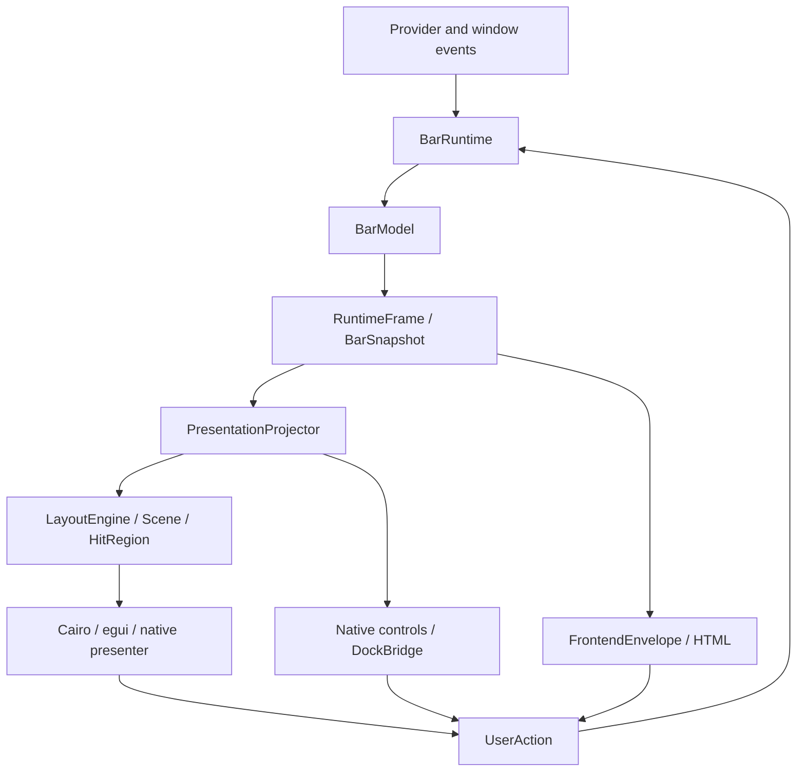

# xbar_core

`xbar_core` 0.9 is the backend-neutral status-bar kernel shared by the XCB,
x11rb, winit, tao, wgpu, pixels, softbuffer, toolkit, and web bars in JWM.

The default build has no window-system, Cairo, ALSA, sysfs, logging, or shared
memory dependency. There is no compatibility umbrella and no `legacy-full`:
every frontend selects only the adapters it actually uses.

This repository is also a workspace for narrow companion adapters. Companion
crates depend on `xbar_core`, never the reverse, so framework and platform
dependencies cannot leak into the portable kernel. Current adapters:
`xbar_linux_actions` (process effects, checked command output, and the
standard `EffectRouter` host route), `xbar_present_wgpu` (wgpu surface
lifecycle and damage-aware CPU-frame presentation), `xbar_dbus_providers`
(UPower battery and MPRIS now-playing over D-Bus), and `xbar_tauri` (the
complete webview bridge). Releases are tagged; consumers pin `tag = "vX.Y.Z"`.

## Architecture



- `BarModel` is the only semantic state owner. It reduces typed `BarEvent`
  values and emits change hints plus typed `BarEffect` values.
- `BarSnapshot` is an owned, serializable projection for toolkit, Tauri, and
  asynchronous consumers; it includes rich provider detail such as per-core
  CPU/memory counters and audio-device capabilities. `BarView` is the borrowed
  render fast path.
- `RuntimeFrame` captures a revision, accumulated changes, snapshot, issues,
  and platform work coherently. `FrontendEnvelope`, `SnapshotCursor`, and
  `ActionRequest` provide one host-neutral wire contract without a Tauri
  dependency or framework-specific DTO copies.
- `FrontendSession` combines a runtime, portable cadence, and delivery cursor
  for hosts that want one `service`/`dispatch` API. Its `SessionOutput` always
  retains the coherent frame for platform work while emitting an envelope only
  when frontend-observable state changed.
- `display` centralizes availability-aware metric tones, volume bands, byte
  formatting, Nerd Font symbols, monitor labels, and explicit JWM layout IDs.
  The geometry-free presentation projection gives widget toolkits the same
  control state and input bindings used by the scene layout.
- `BarRuntime` coordinates optional providers and transport without absorbing
  platform/window responsibilities. It can own transport opening, bounded
  reconnects, lifecycle status, and notifier generations.
- `RuntimeSchedule` gives high-frequency event loops one portable service
  call: transport is polled every turn while providers tick at a bounded
  monotonic cadence.
- `LayoutEngine` produces a renderer-neutral retained `Scene` and semantic hit
  map. Its four-edge axis model allocates workspace, layout, status and Dock
  groups while keeping text and thumbnails upright. Responsive priorities and
  overflow preserve access on short outputs. `Scene::damage_from` invalidates
  both old and new component bounds.
- `DockReporter` owns acknowledged shelf/item geometry, hover leases,
  50 ms-bounded moving-anchor refreshes, and bounded retries.
  `toolkit_dock::DockBridge` adds the shared retained-toolkit
  layout without coupling one bar package to another. Each rendered item
  captures its `DockItemBinding`; callbacks never reconstruct an action from
  the bridge's newer session/generation state.
- `BarEdge`, `BarPlacement`, `EwmhStrut` and `LayerShellPlacement` centralize
  edge-specific native geometry. Managed snapshots already carry the bar's
  actual physical origin; `from_bar_geometry` consumes it without applying
  bottom/right offsets twice.
- `web_layout` provides shared HTML axis CSS, visible keyboard focus and
  scrolling-aware DOM geometry. It is installed by the Tauri and Dioxus hosts
  without duplicating orientation logic in each frontend framework.
- `CairoBar` is the high-level native facade combining runtime, layout,
  interaction, and Cairo rendering. Its `handle_pointer` API owns hover and
  matching press/release semantics, including the captured action identity
  across model updates.

## Four-edge presentation

`BarEdge::{Top, Bottom, Left, Right}` selects the physical output edge; `Top`
is the backward-compatible default. `PresentationConfig.edge` carries it to
renderers. Horizontal bars allocate along x; vertical bars allocate along y.
Only coordinates and allocation axes change: text and images are never rotated.

The shared TOML file, normally `~/.config/xbar/config.toml`, uses:

```toml
[presentation]
position = "left"
thickness = 42.0
```

`thickness` aliases the existing `bar_height` key. Use one of them; both mean
logical cross-axis thickness. JWM-managed bars instead receive their effective
`JWM_BAR_POSITION` and `JWM_BAR_THICKNESS`, with thickness in physical pixels.
`BarConfig::load_default` validates those overrides. The physical value is
stored as `PresentationConfig.physical_thickness`; call
`logical_thickness(scale_factor)` when preparing a native logical allocation.
Thus 48 managed physical pixels become 24 logical pixels at 2×. Standalone
`thickness = 48.0` remains 48 logical pixels at that scale. `XBAR_POSITION` is
a standalone edge override when `JWM_BAR_POSITION` is absent.

For managed transport snapshots, `MonitorGeometry.x/y` already include the
bar's padding and bottom/right placement. `width` is the bar's actual physical
width. A vertical snapshot carries its available length in `height`; horizontal
snapshots preserve the legacy output-height field. Use
`BarPlacement::from_bar_geometry` with the effective logical thickness and
scale. `BarPlacement::at_edge` takes a raw output rectangle instead. Global Dock
targets add the authoritative physical origin once to scaled local bounds.

The Scene protects the active workspace, clock and important controls when
space is constrained. `WorkspaceOverflow` and wheel navigation preserve access
to the complete tag list; `StatusOverflow` opens the Shell Hub. On sidebars,
`ControlSpec::sidebar_lines` supplies upright clock components and compact
readings. `accessible_label` and `tooltip_text` retain full semantic labels for
native adapters. Controls reserve at least 32 logical pixels along the main
axis when space permits, with fixed hit regions spanning the bar thickness.
Native host keyboard handling remains separate from the Scene pointer facade.

### Exact retained Dock allocations

`DockMetrics` computes upright card dimensions, bounded magnification and
fixed acquisition slots for both orientations. Drawing and reporting use the
same calculations. Persistent compositor targets use resting card bounds;
preview and restore use the current visual bounds.

Call `DockBridge::set_edge(edge)` before synchronizing a retained frontend.
`synchronize` budgets width on horizontal bars and available height on sidebars.
Its public allocation accessors all use logical, bar-local coordinates:

| API | Meaning |
|---|---|
| `shelf_bounds()` | Exact fixed shelf allocation in the bar root |
| `slot_bounds(token)` | Stable whole-thickness pointer/focus target |
| `resting_item_bounds(token)` | Resting card used for persistent geometry |
| `item_bounds(token)` | Current visual card, with magnification already applied |
| `overflow_bounds()` | Exact overflow affordance allocation |
| `item_size()` / `slot_extent()` | Resting size / fixed main-axis slot extent |

The legacy `shelf_width()` method returns the main-axis extent, which is height
on a sidebar. Place a retained shelf outside scrolling control groups and
reserve this extent from their layout. Subtract the shelf origin when using
child-relative coordinates. Native implicit button padding or a second scale
must not alter the allocation after it has been reported.

Capture `item_binding(token)` in ordinary controls and `overflow_binding()` in
the actionable `+N` control. `overflow_count()` counts known locally omitted
windows. `request_restore(binding)` accepts the current overflow binding and
uses the visible affordance as its animation origin. A protocol overflow flag
alone supplies no token, so it cannot produce a restore binding. Stale
session/generation bindings are rejected and queued intent survives validated
transport recovery.

HTML docks that use their own flow layout report actual DOM geometry through
`web_layout`'s `restingDockRect` and `visibleDockRect` helpers. These account for
transforms, the viewport and nested clipping/scroll ancestors. Scroll and resize
changes republish targets; hidden or detached cards withdraw them. Dioxus uses
the fixed `DockBridge` allocation path. Its Dock remains outside the status
scroller and preserves the same coordinates as the Rust reporter.

See the JWM [four-edge guide](../../docs/bars-four-edges.md) for per-monitor
configuration, saved native Shell Hub controls, work areas, struts, frontend
coverage and the validation matrix.

## Pure model

```toml
[dependencies]
xbar_core = { git = "https://github.com/beamiter/xbar_core.git", default-features = false }
```

```rust
use xbar_core::{BarEvent, BarModel, TagId, UserAction};

let mut model = BarModel::default();
let update = model.update(BarEvent::User(UserAction::ViewTag(
    TagId::new(2).unwrap(),
)))?;

if update.needs_redraw() {
    let snapshot = model.snapshot();
    println!("active tag: {:?}", snapshot.active_tag);
}
# Ok::<(), Box<dyn std::error::Error>>(())
```

## Native Cairo frontend

```toml
xbar_core = { git = "https://github.com/beamiter/xbar_core.git", default-features = false, features = [
  "clock-chrono", "logging-flexi", "provider-alsa", "provider-system",
  "provider-brightnessctl", "provider-battery-sysfs", "transport-shared",
  "runtime-linux", "render-cairo",
] }
```

For core-managed recovery, construct `TransportRecoveryConfig` and use
`BarRuntime::with_managed_transport`; its first poll opens the existing
WM-owned ring and later polls retry boundedly after failures. If low-latency
native notification is useful, create a `SharedEventNotifier` from the current
transport and let `TransportNotifierSlot` rebuild it whenever
`transport_generation()` changes. Then wrap the runtime with
`render::cairo::CairoBar`. Native pointer events map to `PointerInput` (or
through `PointerAction::from_x11_button`/`from_vertical_delta`);
`BarPlacement`, `EwmhStrut`, and the `DockWindowSpec` property protocol
centralize pure window geometry, while `linux::Epoll` owns the native wait
loop. Unhandled `RuntimeUpdate::platform_effects` remain the frontend's
responsibility and can be drained through one `PlatformEffectHandler` policy —
or through `xbar_linux_actions::EffectRouter` for the standard Linux route.

Toolkit and Tauri frontends use the same `BarRuntime` directly. A
`RuntimeSchedule` replaces their local `last_tick`, reconnect deadline, and
`tick + poll` merge logic; `service_frame` returns one coherent state handoff.
Event loops can use `next_service_deadline` to sleep until either the next
provider tick or an earlier managed-transport retry. Web bridges may instead
own a `FrontendSession`, which applies that schedule and snapshot
deduplication together without owning a thread or framework handle.
Native presenters that render the minimized Dock also combine that wake with
`CairoBar::next_dock_deadline` or `DockBridge::next_retry_deadline`. Provider
ticks keep their normal cadence; only a pending 50 ms anchor, 100 ms
backpressure retry, or two-second preview lease wakes the loop sooner.
Toolkits consume the geometry-free control projection, while web bridges send
a complete `FrontendEnvelope` and dispatch a single `ActionRequest`. They do
not depend on `shared_structures` or instantiate provider managers themselves.
`SystemDetails` and `AudioDeviceInfo` preserve rich provider data without
leaking adapter types.
If the shared transport breaks, the runtime drops it, marks the WM projection
unavailable, returns geometry-clear work, and schedules its own reopen. A
reopened transport remains command-gated until its first authoritative WM
snapshot arrives; stale availability and monitor selection are never owned by
widget state.

```rust
use std::time::Duration;
use xbar_core::{BarRuntime, ModelConfig, RuntimeSchedule, SnapshotCursor,
    TransportRecoveryConfig};

let recovery = TransportRecoveryConfig::new("/run/user/1000/jwm", Duration::from_secs(2))?;
let mut runtime = BarRuntime::with_managed_transport(ModelConfig::default(), recovery)?;
let mut schedule = RuntimeSchedule::default();

// Call from a framework timer, idle callback, or native event-loop turn.
let frame = schedule.service_frame(&mut runtime);
let mut cursor = SnapshotCursor::new();
if let Some(envelope) = cursor.update_frame(&frame) {
    # let _ = envelope; // emit/store one complete, revisioned snapshot
}
# Ok::<(), Box<dyn std::error::Error>>(())
```

## Features

| Feature | Capability |
|---|---|
| `clock-chrono` | Chrono clock adapter used by `BarRuntime::tick` |
| `config-toml` | validated shared TOML `config::BarConfig` with XDG lookup |
| `logging-flexi` | `logging::init` with rotation |
| `provider-alsa` | ALSA audio manager/runtime adapter |
| `provider-system` | sysinfo CPU/memory provider (no battery dependency) |
| `provider-brightnessctl` | panel backlight provider with brightnessctl and sysfs/logind fallback |
| `provider-network-sysfs` | dependency-free primary-interface throughput provider |
| `provider-battery-sysfs` | independent deterministic multi-battery sysfs provider |
| `transport-shared` | typed JWM transport plus core-managed bounded recovery |
| `runtime-linux` | `AlignedTimer`, owned token-based `Epoll`, reconnect-aware notifier ownership, and owned wake forwarding |
| `render-cairo` | Scene-based `CairoRenderer`, text measurer, `CairoBar`, and validated CPU-frame rendering (`render_into_bgra`, `CpuCanvas`) |
| `glass` | Compositor-coupling constants (`fallback_rgb`, `DEFAULT_BACKGROUND_OPACITY`) for every native and toolkit bar, plus the baked-backdrop machinery (`frost`, `GlassCache`, the `WallpaperSource` trait, Cairo surface conversions when `render-cairo` is on) that only the Tauri bridge still consumes |
| `glass-wallpaper` | `glass` plus the file-backed `WallpaperFile` source and PNG/data-URL export (adds an image codec); consumed only by the Tauri webview frontends |

### Frosted glass

A bar cannot see through itself, so real glass is the compositor's to provide.
Every non-Tauri bar decides its mode once at startup, detection first: is a
compositing manager active (`_NET_WM_CM_S<screen>` has an owner, or the
toolkit's equivalent signal), and can this pipeline actually deliver per-pixel
alpha to the server? When both hold, the bar creates a translucent window and
paints its background at `background_opacity` (default
`glass::DEFAULT_BACKGROUND_OPACITY`, 0.55) so the compositor blends — and,
under JWM, blurs — the desktop behind it. When either fails, the bar paints
`glass::fallback_rgb(theme)` fully opaque; the opacity key is ignored rather
than washed over an undefined clear. The check is startup-only (the visual is
a creation-time decision), and owning the CM selection only proves compositing
is on, not that any blur is configured behind the bar.

The baked path — sample the wallpaper where the bar sits, blur and saturate
that strip, draw the scene over it — still lives in this module, but only the
Tauri webview bridge takes it: `backdrop-filter` blurs what is inside the
page, never the desktop behind the window, so the page is handed a pre-frosted
strip as a PNG (`to_png`, `to_png_data_uri`) and composites its own tint over
it in CSS. Point `glass.wallpaper` at the file the compositor draws;
`GlassStrip`, `WallpaperFile`, `GlassCache`, `frost`, and the Cairo
conversions remain for that consumer and should not gain new ones.
`render_over(None)` is still exactly `render`, so retained Cairo call sites
keep compiling either way.

## Icons

Two different things in a bar are called icons, and they fail in two different
ways.

**Glyph icons** — tags, the metrics cluster, the shell entry — are private-use
code points from a patched Nerd Font. A bar's `font` is normally a UI face that
has none of them, so Pango resolves each one through the generic fontconfig
sort, and the private use area is unassigned: any installed font may claim those
code points, and stock Arial claims several. That is how a gear tag renders as a
stray tick and a home tag as an empty box, on one machine and not the next.
`icon_font` fixes the family that backs those glyphs; leaving it unset lets
`icon_font::select_icon_family` pick an installed patched font deterministically
(`XBAR_ICON_FONT` overrides it for one process). Cairo frontends apply this
inside `CairoBar::new`, so no bar has to thread a second font through.

```toml
[presentation]
icon_font = "Symbols Nerd Font Mono"   # optional; auto-detected when omitted
```

**The window icon** is the real desktop icon of the application owning the
focused window, drawn beside its title. JWM sends the X11 class or Wayland
app-id in the monitor snapshot; `app_icon::AppIconResolver` turns that into a
file through the freedesktop desktop-entry and icon-theme lookup (including
`StartupWMClass`), caching every answer — misses included, since a miss is the
one that costs a directory walk. `BarRuntime` resolves on focus changes and the
scene carries a `SceneNode::Image` naming the file, so each renderer decodes and
caches textures its own way. Only raster icons are offered: no renderer here
carries an SVG rasterizer, and an application with a scalable-only icon shows
its title alone rather than a placeholder. `visibility.client_icon = false`
turns it off; `ModelConfig::resolve_client_icons = false` stops the lookup
entirely.

## Layouts

`display::CANONICAL_LAYOUTS` is the one table describing JWM's layouts — wire
id, name, symbol, label — in cycle order. JWM derives its own cycle, symbols and
labels from it, so a layout added there reaches every bar's layout menu without
a second edit.

The menu still follows the *running* window manager rather than the table it was
compiled against: each snapshot carries how many layouts the compositor offers
and which one is in use, so a compositor with fewer layouts drops the entries it
cannot enter, one with more gets the extra ids appended by number, and the
active entry is marked from the id instead of guessed from the symbol.

## Shell surface

Bars can reach the window manager's own shell — launcher, notification center,
clipboard history, calendar, wallpaper picker — the way DMS, Noctalia,
Caelestia, and end-4 all do it: one bar entry that routes to every page.

`xbar_core` implements none of those pages. `ShellRoute` names one, and
`UserAction::OpenShellHub` asks the window manager to open it; everything the
page then does belongs to the window manager. A bar therefore gains the whole
feature without gaining any shell state to keep in sync.

```rust
use xbar_core::{ShellRoute, UserAction};

// One cell reaches every page: primary opens it, scroll walks the cycle.
let open_notifications = UserAction::OpenShellHub(ShellRoute::Notifications);
assert_eq!(ShellRoute::Hub.next(), ShellRoute::Applications);
assert_eq!(ShellRoute::from_key("control-center"), Some(ShellRoute::Hub));
```

`CairoBar` / `LayoutEngine` frontends project the entry automatically; toolkit
and webview frontends dispatch the action from their own widget. The entry is
tied to `wm_available`, so an unreachable window manager grays it out instead
of swallowing the click. See [docs/MIGRATION-0.8.md](docs/MIGRATION-0.8.md) for
the wire encoding, configuration keys, and default bindings.

## Companion crates

```toml
[dependencies]
xbar_core = { git = "https://github.com/beamiter/xbar_core.git", default-features = false }
xbar_linux_actions = { git = "https://github.com/beamiter/xbar_core.git" }
xbar_tauri = { git = "https://github.com/beamiter/xbar_core.git", features = [
  "clock-chrono", "provider-alsa", "provider-battery-sysfs",
  "provider-brightnessctl", "provider-system",
] }
```

```rust
use xbar_core::{BarEffect, PlatformEffectHandler};
use xbar_linux_actions::{CommandRunner, CommandSpec, ProcessActionHandler};

let mut actions = ProcessActionHandler::default();
actions.handle(BarEffect::Screenshot)?;

let output = CommandRunner::output(
    &CommandSpec::new("ip").with_args(["-4", "-o", "addr"]),
)?;
# Ok::<(), Box<dyn std::error::Error>>(())
```

Action policy is configurable through `ProcessActionConfig`. The screenshot
pill defaults to `ScreenshotAction::Jwm`, which asks the running compositor for
its own interactive region capture over jwm's control socket rather than
spawning an external grabber — the compositor already owns the framebuffer and
the pointer grab, and under Wayland an X11 grabber cannot see the screen at
all. `ScreenshotAction::Command(spec)` restores the old behaviour (e.g.
`flameshot gui`) for hosts that want it, and `ScreenshotAction::Disabled` turns
the pill off. Audio control still defaults to `pavucontrol`. Window placement,
provider effects, and WM commands are rejected as unsupported so another host
adapter can handle them explicitly. `CommandRunner` reuses `CommandSpec` for output-producing
host probes, rejects non-zero exits, retains stderr in its error, and never
invokes a shell implicitly. Its default runner also enforces a ten-second
deadline and retains at most one mebibyte from each output stream;
`output_with_limits` lets a known slower probe choose explicit bounds.

`xbar_tauri::configure` installs the shared runtime worker, managed transport,
one `xbar-state` event, `dispatch_action`, `frontend_ready`, scale-aware window
placement, and the process-action adapter onto a caller-supplied Tauri builder.
Each application keeps its own generated context and optional plugins.

## Validation

From the JWM repository root, the shared kernel and actual render fixture are:

```bash
cargo test -p xbar_core --no-default-features
cargo test -p xbar_core --no-default-features --features render-cairo
cargo test -p xbar_core --all-features
cargo clippy -p xbar_core --all-targets --all-features -- -D warnings
cargo doc -p xbar_core --no-default-features --no-deps
cargo run -p xbar_core --features render-cairo --example render_four_edges -- /tmp/jwm-bar-previews
```

The fixture uses the production Cairo/Pango scene with populated workspaces,
status and minimized-window cards. It writes a PNG and matching scene JSON for
each of four edges, two themes and two DPI scales without a display server.
Portable labels make the geometry inspectable without an installed Nerd Font.

The four-edge change has passed 365 all-feature unit tests and 2 doctests.
Tests cover all four orientations, short/thin viewports, negative desktop
origins, 1×/1.25×/2× geometry, upright text/cards, complete workspace traversal,
fixed Dock hits, visual versus persistent anchors, stale bindings and recovery.

GUI companions and bars are intentionally outside the root Cargo workspace;
check them through their own manifests. `xbar_tauri` has an explicit
`[workspace]` boundary for standalone checks:

```bash
cargo check --manifest-path crates/xbar_core/crates/xbar_tauri/Cargo.toml
cargo test --manifest-path crates/xbar_core/crates/xbar_tauri/Cargo.toml --lib
cargo test --manifest-path crates/xbar_core/crates/xbar_gtk/Cargo.toml
cargo check --manifest-path bars/tao_glow_bar/Cargo.toml
node scripts/test_bar_layout.mjs
```

The Tauri bridge passes 13 library tests, including four-edge standalone
placement; the GTK adapter passes 11 tests. The 22 non-Tauri frontend packages
pass package checks, and Leptos/Yew pass `wasm32-unknown-unknown` target checks.
The browser script requires Playwright/Chromium and exercises the seven HTML
frontends' real stylesheets with controlled DOM fixtures: 84 edge/size/focus
cases, scrolling/transformed geometry and four exact pinned Dock allocations.
After building React/Solid/Svelte/Vue with `npm run build` in each frontend,
`node scripts/test_bar_web_frontends.mjs` exercises 16 cases using the actual
production bundles at all four edges. Its Chromium host mocks Tauri IPC and
verifies readiness, exactly-once keyboard actions, clipped/scrolling Dock
reports and restore geometry. This does not exercise the native Tauri/WebKit
runtime.

Package compilation and fixture tests remain distinct from native visual
validation. `tao_glow_bar` and GTK have four-edge X11 smoke coverage; the change
does not claim complete physical Wayland or all-toolkit visual validation.
The experimental Iced adapter lacks explicit bar keyboard traversal, and
Xilem's in-window tooltips can clip on narrow sidebars. JWM's native minimized
previews use the correct inward-facing placement independently of those local
tooltip limitations.

See [docs/ARCHITECTURE.md](docs/ARCHITECTURE.md) for module ownership,
[docs/CONSUMER-MATRIX.md](docs/CONSUMER-MATRIX.md) for every JWM bar family,
[docs/COMPANION-CRATES.md](docs/COMPANION-CRATES.md) for adapter boundaries,
[docs/MIGRATION-0.9.md](docs/MIGRATION-0.9.md) for compositor-coupled
translucency, and [docs/MIGRATION-0.7.md](docs/MIGRATION-0.7.md) for the
network/media states
([0.6 presentation/config](docs/MIGRATION-0.6.md),
[0.5 host-integration](docs/MIGRATION-0.5.md),
[0.4 projection/bridge](docs/MIGRATION-0.4.md), and
[0.3 lifecycle](docs/MIGRATION-0.3.md) notes remain relevant).

The repository intentionally does not declare a license until the project
owner selects and adds one.
