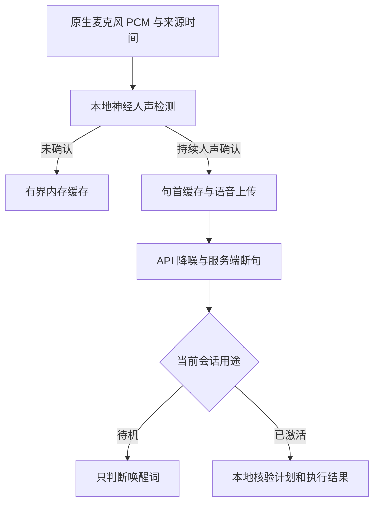

# Eva 本地人声检测与防误触发

更新日期：2026-11-01。适用范围：独立 `jwm-eva` 服务的快捷键会话、后续轮、云端唤醒与自然打断。

## 要解决的问题

此前待机上传门控使用电平累计，正式会话的连接缓存和实时输入会直接上传；播放结束后的缓存也能直接回放到云端。电平高只能证明“有声音”。纯音、环境噪声、风扇、键盘敲击等可能先进入模型，再产生错误的起声、转写或唤醒判断。原有打断检测增加了音高与底噪门限，但音调噪声仍可能通过，低增益或气声也可能被拒绝。

本次将“本地确认语音”“云端降噪”“判断是否说完”“执行桌面动作”分开处理。既有模型、账户凭据、预算及动作许可机制保留。



## 实现与边界

### 本地检测

- 默认内置 Silero VAD v5.1.2 ONNX 模型，MIT 许可与固定 SHA-256 随源码分发；通过本机 ONNX Runtime CPU API 22 推理，普通 Rust 消费线程执行，原生实时回调只做有界复制。无 Python 服务、GPU 或运行时模型下载。
- 24 kHz、单声道、S16LE、20 ms 输入经有状态抗混叠 FIR 转为 16 kHz，累计为 512 个新样本的 32 ms 模型窗口，另保留 64 个上下文样本与 `[2,1,128]` 循环状态；输入不补零，原始上传 PCM 和时间戳不变。
- 缺少 feature、运行库或模型，或者模型校验失败时，按 `local_voice_fallback = "rnnoise"` 显式降级到内置 `nnnoiseless 0.5.2`；该后端使用 24→48 kHz FIR 与频谱纯音/白噪声否决。设为 `"none"` 则阻止上传。`doctor` 和日志明确显示实际后端与固定降级原因，能量门控不算 Silero。模型来源、运行库安装与离线分发见 [eva/models/README.md](../eva/models/README.md)。
- 默认分数门限 0.65，约 240 ms 窗口内需要 160 ms 有效人声证据，允许少量辅音或短间隙。非常短的单字、耳语和强混响仍需要实机调参。
- 默认保留确认窗口之前 400 ms 的句首音频；缓存另覆盖确认时长、服务端 prefix padding 和少量余量。其总长度有上限，不会累积长期录音。
- 模型只提供人声证据，不提供说话人身份、唤醒意图或桌面权限。电视、语音视频、其他人以及 Eva 回声都可能包含真实人声。

### 上传边界

快捷键激活后的连接缓存、正常听音、唤醒待机、打断后的回放以及普通反馈结束后的候选输入都经过同一个本地上传门控。正常反馈结束并不意味着缓存中存在有效的新命令。

确认之前只保留有限内存缓存。确认后发送句首与语音，所以已接受片段可能包含少量前置背景声；不能将其描述为“绝无任何环境音上传”。短辅音与停顿不逐帧裁切，连续非人声持续 240 ms 后以零静音提供尾部样本，服务端仍能正常结束该轮。本地不会在 server/semantic VAD 之外重复发送 commit。

服务端起声晚于本地关门时，只能补发有界尾静音或重新经过确认的语音，不能凭迟到事件恢复连续原始音频上传。云端的音频时间轴按实际 append 的样本累计，继续由 `InputGate` 映射回真实来源时间；没有把墙钟时间当成云端音频时间。

原生图时钟尚未就绪的启动帧留在本地，后续有效帧仍可启动会话。唤醒移交在服务端边界切出的不足 20 ms 的合法片段会重新拼帧。来源倒序、非法格式或中断不会静默降级为全量上传。

### 音质、打断与回声

在线上传保留原始 PCM 与原生时间戳；RNNoise 的降噪结果供本地判定和离线评估，云端使用已配置的输入降噪。这样避免双重抑噪和将有固定延迟的处理结果贴上错误的来源时间。离线接口返回的降噪 PCM 比来源延迟 272 个 24 kHz 样本，不能无补偿地替换原生 Frame。

自然打断需要本地人声确认，并保留来源时效、连续性、上一句的 160 ms 安静间隔和播放回声比对。神经确认路径不再强制要求旧的固定音高或高于底噪约 16 dB 的门限。有效插话停止本地播放、取消当前响应，并按真实播放进度修复会话历史；旧响应和迟到字幕不能取得新一轮权限。

原生音频向会话管理器申请 echo-cancel 只是请求，不证明系统实际配置了带播放参考的 AEC。相关性检查也不等于完整的自适应回声消除。耳机与外放、不同房间混响都应分别验收。

## 配置

修改已有 `~/.config/jwm/eva.toml` 的相应字段，不要重复添加同名 TOML section。旧文件中的显式模型、阈值、语言或设备设置不会被自动覆盖；缺省的新字段使用下列默认值。

```toml
[audio]
local_voice_detection = true
local_voice_backend = "silero"
local_voice_fallback = "rnnoise" # "none" 则缺依赖时禁止上传
local_voice_threshold = 0.65
local_voice_min_ms = 160
local_voice_preroll_ms = 400
noise_reduction = "near_field"
noise_reduction_strength = 1.0

[turn_detection]
type = "semantic_vad"
eagerness = "auto"
# 以下三项仅在 server_vad 生效；mini 待机始终使用 server_vad。
threshold = 0.65
prefix_padding_ms = 300
silence_duration_ms = 650
create_response = false
interrupt_response = false

[wake_word]
local_speech_gate = true
```

`near_field` 适合耳麦或近讲麦克风，笔记本内置/房间麦克风可选 `far_field`。`noise_reduction_strength` 范围为 0–1；`off` 关闭云端降噪，并不关闭本地人声检测。服务端 `threshold` 越高越要求较响输入，不是人声身份置信度；`semantic_vad` 判断表达是否结束，也不替代本地 VAD。

本地分数门限允许 0.1–0.95；确认时长允许 80–500 ms 且为 20 ms 倍数；前置缓存允许 200–1000 ms 且为 20 ms 倍数。降低确认时长有利于极短命令，同时可能提高误触发；提高门限有利于拒绝模糊输入，也可能漏掉轻声。所有默认值都是工程起点。

额外字幕默认关闭。需要显示字幕时，可配置语言和短术语，模型仍直接理解音频，字幕不能触发执行：

```toml
[openai]
input_transcription = true
input_transcription_language = "zh"
input_transcription_keywords = ["Eva", "JWM", "tag", "tile", "scrolling"]
```

语言和关键词仅在开启字幕时发送；只填词语，不填希望模型“听到”的整条命令。输入转写是独立异步过程，并不精确等于 Realtime 模型实际听到的内容。

`keep_warm` 保持原有行为：允许预先建立空闲 WebSocket 会话以降低唤起延迟。本次保证的是语音数据和推理在本地门控之后发送，不能据此声称“无语音时绝无任何网络连接”。

## 可观察性

- 听音浮层区分“本地检测人声，环境声不上传”与“人声已确认，正在听”；后续轮继续保留已核验的上一轮结果。
- `jwm-eva status --json` 的 `data` 与 `wake` 包含 `upload_gate`、`voice_probability`、`uploaded_ms`、`suppressed_ms`。这些是检测与数据传输指标，不是命令成功率。
- `jwm-eva doctor` 显示本地检测引擎、分数门限、确认时长、前置缓存与云端降噪强度。普通 doctor 不录音、不请求推理。
- 日志中的 `local_voice_confirmed`、`standby_gate_summary`、`barge_in_progress`、`barge_in_window` 只包含允许的汇总字段，原始 PCM、转写文字与音频参考不写入遥测。

安装新二进制后重启用户级 `jwm-eva.service`。仓库修改本身不会更新正在运行的桌面程序。

## 验证与真实设备验收

回归使用公开上游录音与合成反例，来源、许可和重现命令见 [fixture 说明](../eva/tests/fixtures/README.md)。检测测试覆盖静音、白噪声、低频风扇混合嗡声、键盘冲击、多个频率纯音、双音及多谐波元音。600 ms 语音片段在 1.0、0.5、0.2、0.1 幅度下能通过默认检测；该单样本结果不能推广成弱声召回率。

门控测试覆盖真实语音的句首缓存、元数据电平不能伪造人声、半帧移交、迟到服务端事件、连续性重置、错误关闭上传、取消后的背景声不重新上传以及 cloud timeline 的来源映射。模型校验测试覆盖降噪强度和可选字幕字段的真实配置回读约束。

运行离线套件使用仓库包装器（它会自动添加 `--locked`）：

```bash
bash scripts/test.sh -p jwm-eva -p jwm_eva_core -p jwm_ipc_client
```

隔离 PipeWire/PulseAudio 测试验证原生格式、时间戳、完整播放、取消、历史修复与资源释放。合成音频图不是用户真实麦克风、扬声器、网络和模型的端到端验收；真实 API 测试仍需要相应凭据并显式执行。

### RNNoise 基线历史验证记录（add8bd72，非本轮 Silero 证明）

环境为隔离 Linux 容器、Rust 1.99.1、私有 PipeWire 1.6.10；没有连接用户桌面，也没有调用付费模型 API。

| 检查 | 本次结果 |
| --- | --- |
| Eva、共享核心和 IPC client 完整离线套件 | 411 passed / 0 failed / 12 ignored |
| 最后补充两项回归后，重跑全部 `session::tests::` | 66 passed / 0 failed / 5 ignored；包含轻声打断的模型状态保留、clear 提前确认时的回放来源顺序 |
| `cargo check --locked -p jwm-eva` | 通过；Rust 1.99 的既有 `Atomic::fetch_update` 弃用警告保留 |
| 修改的 Rust 文件格式检查、`git diff --check` | 通过 |
| 原生 PipeWire | 两项测试分别在 24 kHz 和 48 kHz 音频图运行，四次全部通过；客户端始终为 24 kHz mono PCM16 |
| 原生 PulseAudio | 两项测试通过 |

完整套件的 411 项与会话复跑的 66 项存在重叠，不能相加为总测试数。原生测试另行显式执行，不表示普通离线套件的所有 ignored 项都已通过。语音素材来自上游公开测试录音，合成噪声测试与该样本不构成真实环境误检率或召回率统计。

真实设备按同一麦克风分别记录以下结果，不能把离线门控通过计为这些项目通过：

| 场景 | 观察内容 |
| --- | --- |
| 10 分钟安静、风扇与打字 | 非预期 gate opening、上传时间、唤醒或执行次数 |
| 正常声与轻声的 20 条中文指令 | 漏检、首字完整性、开门延迟、执行结果 |
| “停”“撤销”“静音”等短词 | 极短词召回与误触发的权衡 |
| 电视/会议人声 | VAD 可认作人声，未经唤醒不能获得普通桌面权限 |
| Eva 外放播报 | 自唤醒、自打断、回声回灌与真实插话 |
| 已生成完成但仍在播放时插话 | 停播时延及未播放部分的历史截断 |
| 唤醒词后不暂停直接说命令 | 移交片段连续、句首不丢失、仅执行一次 |
| 设备切换、暂停恢复、网络延迟 | 不跨代复用音频、不失控上传、不重复执行 |

## 本轮 Silero 与交互验收矩阵

本轮独立云端继续实现；下面各项分别验收，历史结果不计作本轮完成证据。

| 范围 | 验收要求 | 本轮状态 |
| --- | --- | --- |
| 真实 Silero CPU | 真实 ONNX 模型推理；公开语音每帧首尾与时间戳保留；轻声/加噪/240 ms 片段；静音/纯音/白噪声/脉冲不上传；重置/无效与迟到音频 | 6 项真实模型测试通过；短片段使用 80 ms 确认配置 |
| 缺依赖降级 | 缺模型/篡改模型/缺运行库/不兼容库/关闭 feature；显式 RNNoise 或严格阻止上传 | 默认完整套件与关闭 feature 套件均通过 |
| 指令与 IPC | 注册覆盖、消歧/显式屏幕与工作区限定、多步结果核验、打断/暂停/取消/继续/撤销、迟到/重复回执、原始亮度档位读回 | 完整套件通过；IPC 目录覆盖、亮度量化、打断与撤销回归均包含在内 |
| 工程验证 | 默认与关闭 Silero feature、Rust 1.89、格式、lint、安装器校验与重复安装 | Rust 1.89 构建通过；格式/安装冒烟通过；Clippy 20 处既有告警与干净 master 基线一致 |
| 原生合成音频服务 | 私有 PipeWire/PulseAudio 图的采集/播放/取消及资源释放 | 私有 PulseAudio 两项通过且无遗留音频流；PipeWire 因缺 WirePlumber 0.4/media-session 测试策略未运行 |
| 真实麦克风/扬声器 | 真实声学误检、回声、外放插话和短中文指令 | 未执行 |
| 真实 API 与自然语言模型 | 真实语音指令理解、模型准确率、延迟与费用 | 未执行，需单独授权 |
| 用户桌面 | 原生桌面执行与会话重启 | 未执行；本轮不控制用户桌面 |

本轮完整默认套件为 424 passed / 0 failed / 18 ignored（Eva、共享核心、IPC client）；关闭 Silero feature 套件为 356 passed / 0 failed / 12 ignored（Eva）。真实 Silero 6 项和 PulseAudio 2 项分别显式运行，不能将重复覆盖的用例相加成唯一场景总数。严格 `clippy -D warnings` 因 20 处基线告警未通过；普通 Clippy 完成，对照干净 `add8bd72` 的告警种类及数量完全相同。

静态 IPC 清单为 227 个命令、151 个查询、25 个订阅主题（403 个名称均已登记，无未知项）；130 个语义动作、232 个规范能力条目中包含 45 个内部条目，187 个用户能力无未适配项。此清单来自现有注册与完成契约审计，不能等同于 403 种语音命令或真实桌面全部验收通过。

交互补充：`language_context.window_groups.*.explicit_scopes` 提供当前屏幕和当前可见工作区的候选。只有用户明确限定范围时才可缩小候选；裸称“浏览器”仍保留全部同类窗口，多候选必须澄清。粘滞窗口和同时显示多个工作区都保留候选。标题、候选数据和历史结果不构成执行授权。既有本地确认、逐步核验和未知结果禁止自动重试继续生效。

## 主来源

- [OpenAI Realtime VAD](https://developers.openai.com/api/docs/guides/realtime-vad)
- [OpenAI Realtime 音频配置](https://developers.openai.com/api/reference/resources/realtime/subresources/client_secrets/methods/create)
- [OpenAI Realtime 会话与打断](https://developers.openai.com/api/docs/guides/realtime-conversations)
- [OpenAI Realtime 转写事件](https://developers.openai.com/api/reference/resources/realtime/server-events)
- [nnnoiseless 0.5.2 固定源码](https://github.com/jneem/nnnoiseless/tree/924a2dd143ccad7bce9e5bda061b60ca32911a67)
