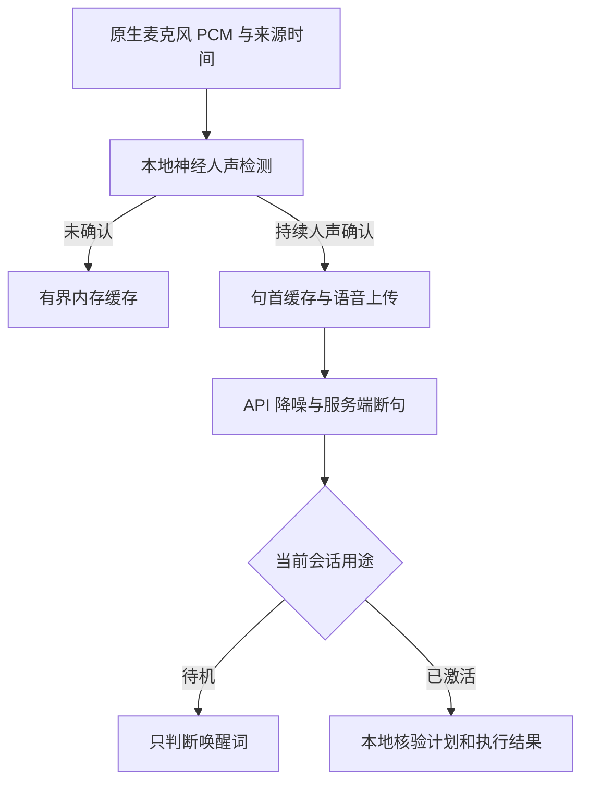

# Eva 本地人声检测与防误触发

更新日期：2026-11-01。适用范围：独立 `jwm-eva` 服务的快捷键会话、后续轮、云端唤醒与自然打断。

## 要解决的问题

此前待机上传门控使用电平累计，正式会话的连接缓存和实时输入会直接上传；播放结束后的缓存也能直接回放到云端。电平高只能证明“有声音”。纯音、环境噪声、风扇、键盘敲击等可能先进入模型，再产生错误的起声、转写或唤醒判断。原有打断检测增加了音高与底噪门限，但音调噪声仍可能通过，低增益或气声也可能被拒绝。

本次将“本地确认语音”“云端降噪”“判断是否说完”“执行桌面动作”分开处理。既有模型、账户凭据、预算及动作许可机制保留。



## 实现与边界

### 本地检测

- 默认内置 Silero VAD v5.1.2 ONNX 模型，MIT 许可与固定 SHA-256 随源码分发；通过本机 ONNX Runtime CPU API 22 推理，普通 Rust 消费线程执行，原生实时回调只做有界复制。无 Python 服务、GPU 或运行时模型下载。
- 24 kHz、单声道、S16LE、20 ms 输入经有状态抗混叠 FIR 转为 16 kHz，累计为 512 个新样本的 32 ms 模型窗口，另保留 64 个上下文样本与 `[2,1,128]` 循环状态；输入不补零，原始上传 PCM 和时间戳不变。
- 缺少 feature、运行库或模型，或者模型校验失败时，按 `local_voice_fallback = "rnnoise"` 显式降级到内置 `nnnoiseless 0.5.2`；该后端使用 24→48 kHz FIR 与频谱纯音/白噪声否决。设为 `"none"` 则阻止上传。`doctor` 和日志明确显示实际后端与固定降级原因，能量门控不算 Silero。模型来源、运行库安装与离线分发见 [eva/models/README.md](../eva/models/README.md)。
- Silero 默认分数门限 0.50（`silero_voice_threshold`），RNNoise 默认 0.65（`local_voice_threshold`），按实际后端选择；约 240 ms 窗口内需要 160 ms 有效人声证据，允许少量辅音或短间隙。非常短的单字、耳语和强混响仍需要实机调参。
- 默认保留确认窗口之前 400 ms 的句首音频；缓存另覆盖确认时长、服务端 prefix padding 和少量余量。其总长度有上限，不会累积长期录音。
- 模型只提供人声证据，不提供说话人身份、唤醒意图或桌面权限。电视、语音视频、其他人以及 Eva 回声都可能包含真实人声。

### 上传边界

快捷键激活后的连接缓存、正常听音、唤醒待机、打断后的回放以及普通反馈结束后的候选输入都经过同一个本地上传门控。正常反馈结束并不意味着缓存中存在有效的新命令。

确认之前只保留有限内存缓存。确认后发送句首与语音，所以已接受片段可能包含少量前置背景声；不能将其描述为“绝无任何环境音上传”。短辅音与停顿不逐帧裁切，连续非人声持续 240 ms 后以零静音提供尾部样本，服务端仍能正常结束该轮。本地不会在 server/semantic VAD 之外重复发送 commit。

服务端起声晚于本地关门时，只能补发有界尾静音或重新经过确认的语音，不能凭迟到事件恢复连续原始音频上传。云端的音频时间轴按实际 append 的样本累计，继续由 `InputGate` 映射回真实来源时间；没有把墙钟时间当成云端音频时间。

原生图时钟尚未就绪的启动帧留在本地，后续有效帧仍可启动会话。唤醒移交在服务端边界切出的不足 20 ms 的合法片段会重新拼帧。来源倒序、非法格式或中断不会静默降级为全量上传。

### 音质、打断与回声

在线上传保留原始 PCM 与原生时间戳；RNNoise 的降噪结果供本地判定和离线评估，云端使用已配置的输入降噪。这样避免双重抑噪和将有固定延迟的处理结果贴上错误的来源时间。离线接口返回的降噪 PCM 比来源延迟 272 个 24 kHz 样本，不能无补偿地替换原生 Frame。

自然打断需要本地人声确认，并保留来源时效、连续性、上一句的 160 ms 安静间隔和播放回声比对。神经确认路径不再强制要求旧的固定音高或高于底噪约 16 dB 的门限。有效插话停止本地播放、取消当前响应，并按真实播放进度修复会话历史；旧响应和迟到字幕不能取得新一轮权限。

原生音频向会话管理器申请 echo-cancel 只是请求，不证明系统实际配置了带播放参考的 AEC。相关性检查也不等于完整的自适应回声消除。耳机与外放、不同房间混响都应分别验收。

## 配置

修改已有 `~/.config/jwm/eva.toml` 的相应字段，不要重复添加同名 TOML section。旧文件中的显式模型、阈值、语言或设备设置不会被自动覆盖；缺省的新字段使用下列默认值。

```toml
[audio]
local_voice_detection = true
local_voice_backend = "silero"
silero_voice_threshold = 0.50
local_voice_fallback = "rnnoise" # "none" 则缺依赖时禁止上传
local_voice_threshold = 0.65
local_voice_min_ms = 160
local_voice_preroll_ms = 400
noise_reduction = "near_field"
noise_reduction_strength = 1.0

[turn_detection]
type = "semantic_vad"
eagerness = "auto"
# 以下三项仅在 server_vad 生效；mini 待机始终使用 server_vad。
threshold = 0.65
prefix_padding_ms = 300
silence_duration_ms = 650
create_response = false
interrupt_response = false

[wake_word]
local_speech_gate = true
```

`near_field` 适合耳麦或近讲麦克风，笔记本内置/房间麦克风可选 `far_field`。`noise_reduction_strength` 范围为 0–1；`off` 关闭云端降噪，并不关闭本地人声检测。服务端 `threshold` 越高越要求较响输入，不是人声身份置信度；`semantic_vad` 判断表达是否结束，也不替代本地 VAD。

本地分数门限允许 0.1–0.95；确认时长允许 80–500 ms 且为 20 ms 倍数；前置缓存允许 200–1000 ms 且为 20 ms 倍数。降低确认时长有利于极短命令，同时可能提高误触发；提高门限有利于拒绝模糊输入，也可能漏掉轻声。所有默认值都是工程起点。

额外字幕默认关闭。需要显示字幕时，可配置语言和短术语，模型仍直接理解音频，字幕不能触发执行：

```toml
[openai]
input_transcription = true
input_transcription_language = "zh"
input_transcription_keywords = ["Eva", "JWM", "tag", "tile", "scrolling"]
```

语言和关键词仅在开启字幕时发送；只填词语，不填希望模型“听到”的整条命令。输入转写是独立异步过程，并不精确等于 Realtime 模型实际听到的内容。

`keep_warm` 保持原有行为：允许预先建立空闲 WebSocket 会话以降低唤起延迟。本次保证的是语音数据和推理在本地门控之后发送，不能据此声称“无语音时绝无任何网络连接”。

## 可观察性

- 听音浮层区分“本地检测人声，环境声不上传”与“人声已确认，正在听”；后续轮继续保留已核验的上一轮结果。
- `jwm-eva status --json` 的 `data` 与 `wake` 包含 `upload_gate`、`voice_probability`、`uploaded_ms`、`suppressed_ms`。这些是检测与数据传输指标，不是命令成功率。
- `jwm-eva doctor` 显示本地检测引擎、分数门限、确认时长、前置缓存与云端降噪强度。普通 doctor 不录音、不请求推理。
- 日志中的 `local_voice_confirmed`、`standby_gate_summary`、`barge_in_progress`、`barge_in_window` 只包含允许的汇总字段，原始 PCM、转写文字与音频参考不写入遥测。

安装新二进制后重启用户级 `jwm-eva.service`。仓库修改本身不会更新正在运行的桌面程序。

## 验证与真实设备验收

回归使用公开上游录音与合成反例，来源、许可和重现命令见 [fixture 说明](../eva/tests/fixtures/README.md)。检测测试覆盖静音、白噪声、低频风扇混合嗡声、键盘冲击、多个频率纯音、双音及多谐波元音。600 ms 语音片段在 1.0、0.5、0.2、0.1 幅度下能通过默认检测；该单样本结果不能推广成弱声召回率。

门控测试覆盖真实语音的句首缓存、元数据电平不能伪造人声、半帧移交、迟到服务端事件、连续性重置、错误关闭上传、取消后的背景声不重新上传以及 cloud timeline 的来源映射。模型校验测试覆盖降噪强度和可选字幕字段的真实配置回读约束。

运行离线套件使用仓库包装器（它会自动添加 `--locked`）：

```bash
bash scripts/test.sh -p jwm-eva -p jwm_eva_core -p jwm_ipc_client
```

隔离 PipeWire/PulseAudio 测试验证原生格式、时间戳、完整播放、取消、历史修复与资源释放。合成音频图不是用户真实麦克风、扬声器、网络和模型的端到端验收；真实 API 测试仍需要相应凭据并显式执行。

### RNNoise 基线历史验证记录（add8bd72，非本轮 Silero 证明）

环境为隔离 Linux 容器、Rust 1.99.1、私有 PipeWire 1.6.10；没有连接用户桌面，也没有调用付费模型 API。

| 检查 | 本次结果 |
| --- | --- |
| Eva、共享核心和 IPC client 完整离线套件 | 411 passed / 0 failed / 12 ignored |
| 最后补充两项回归后，重跑全部 `session::tests::` | 66 passed / 0 failed / 5 ignored；包含轻声打断的模型状态保留、clear 提前确认时的回放来源顺序 |
| `cargo check --locked -p jwm-eva` | 通过；Rust 1.99 的既有 `Atomic::fetch_update` 弃用警告保留 |
| 修改的 Rust 文件格式检查、`git diff --check` | 通过 |
| 原生 PipeWire | 两项测试分别在 24 kHz 和 48 kHz 音频图运行，四次全部通过；客户端始终为 24 kHz mono PCM16 |
| 原生 PulseAudio | 两项测试通过 |

完整套件的 411 项与会话复跑的 66 项存在重叠，不能相加为总测试数。原生测试另行显式执行，不表示普通离线套件的所有 ignored 项都已通过。语音素材来自上游公开测试录音，合成噪声测试与该样本不构成真实环境误检率或召回率统计。

真实设备按同一麦克风分别记录以下结果，不能把离线门控通过计为这些项目通过：

| 场景 | 观察内容 |
| --- | --- |
| 10 分钟安静、风扇与打字 | 非预期 gate opening、上传时间、唤醒或执行次数 |
| 正常声与轻声的 20 条中文指令 | 漏检、首字完整性、开门延迟、执行结果 |
| “停”“撤销”“静音”等短词 | 极短词召回与误触发的权衡 |
| 电视/会议人声 | VAD 可认作人声，未经唤醒不能获得普通桌面权限 |
| Eva 外放播报 | 自唤醒、自打断、回声回灌与真实插话 |
| 已生成完成但仍在播放时插话 | 停播时延及未播放部分的历史截断 |
| 唤醒词后不暂停直接说命令 | 移交片段连续、句首不丢失、仅执行一次 |
| 设备切换、暂停恢复、网络延迟 | 不跨代复用音频、不失控上传、不重复执行 |

## 整体需求完成性矩阵（本轮复核）

基线为 `add8bd72`，本轮在独立 Linux 云端实现和复核。下表区分已有行为、本轮修改与自动测试的实际边界；注册数量不等于语音理解准确率或真实桌面验收。没有调用真实 API，也没有操作用户桌面、麦克风或扬声器。

| 用户需求 | 实现归属与行为 | 本轮证据 | 未覆盖的边界 |
| --- | --- | --- | --- |
| 本地 Silero | 本轮新增真实 v5.1.2 ONNX CPU 后端；24→16 kHz 抗混叠 FIR、512 样本分帧、64 样本上下文与循环状态 | `silero_offline.rs` 8 项真实模型测试；重置后逐分数确定一致 | 单一公开录音与合成噪声不是总体误检率；aarch64 未执行 |
| 前置门控、起止与短句首尾 | 上传状态机已有；本轮接入 Silero。原始 PCM/时间戳不变；本地门控不重复 commit；新 epoch 清空历史 | 真实模型逐帧首尾、半帧 handoff、迟到/重复/未验证来源、静音/纯音/噪声不上传均通过 | 240 ms 裁剪在 20/400 ms 前导静音下仍漏检，80 ms 确认也未消除；不保证极短单字召回，详见下方有界诊断 |
| 缺依赖与失败降级 | 本轮新增分模型门限（Silero 0.50/RNNoise 0.65）、实际后端诊断与显式 RNNoise/严格阻止上传；独立复核后修复 FIFO 卡住初始化、关闭门控仍探测模型 | `voice_backend.rs` 缺库/不兼容/篡改模型/非普通文件/关闭 feature；FIFO 子进程有 2 秒上限 | 失败不自动换成能量门控；禁用门控是用户显式选择连续上传 |
| 指令理解与 context | 已有口语/否定/修正规则、当前/前一窗口、最近已核验效果、相对屏幕与工作区；本轮新增明确屏幕/可见工作区候选与 sticky 信息 | `language.rs`、`context.rs`、`planning_input.rs`；候选不完整、焦点变化、对象替换均有回归 | 没有运行真实模型语义 corpus；自然语言规则与离线工具回包不能证明模型听懂全部指令 |
| 候选消歧 | 已有多候选澄清与发现协议；本轮只为用户明确限定的屏幕/工作区缩小候选，裸称“浏览器”保留全部同类对象 | `explicit_window_scopes_keep_bare_ambiguity_and_include_sticky_windows`，含多可见工作区/缺范围数据 | 模型生成和理解编号澄清仍待真实 API 验收，候选数据不授予执行权限 |
| 多步执行 | 已有最多 32 个冻结步骤，串行执行；每步重新校验许可/身份/当前状态，失败停止，accepted/partial/unknown 不当作成功 | `executor_ipc.rs` 11 个 Unix transport 场景；核心 plan 上限、32 步冻结与严格 schema 回归 | Unix 服务 stand-in 与 WM mock 不覆盖所有外部应用/真实桌面效果 |
| 打断、取消与待续优先级 | 已有停止播放、取消旧响应/未派发步骤、clear fence 后回放新语音；本轮同接 Silero；pause 保留单一待续任务，cancel 清除提案但不擦除 unknown 效果屏障 | `planning_input` 14、`pending_task` 15、`input` 26 等独立复跑；播放历史截断/迟到事件与来源检查；私有音频测试 | 不能声称取消已撤销完成或在途动作；真实外放回声和用户插话仍未验收 |
| 撤销与本地确认 | 已有 undo 必须 `task_intent=new`，独立于待续任务；只撤销最新可逆前沿、反序补偿、核验 expected_state，不能跳过更新/不确定操作；高风险动作仍需本地单次确认 | `undo_ipc.rs` 6 场景；ledger/undo 单元；WM `model_confirmation_never_authorizes_and_local_confirmation_is_single_use`、`undo_poststate_check_is_atomic_and_conflicts_do_not_modify_target` | 自动测试使用隔离 mock；真实确认 UI 操作未执行 |
| IPC 回执与亮度量化 | 已有 master 修复，今回未重复实现。按 operation/sequence/device/raw target 核验，不相信乐观缓存或仅百分比；旧/错误/缺失回执不得完成操作 | 本轮根 JWM `jwm::eva::tests::` 57 项全部通过，含 `eva_quantized_brightness_requires_matching_sequence_device_and_raw_readback`；另有 Unix executor 场景 | 57 项使用 DisplaySpyBackend/测试控制队列，未写真实背光设备 |
| PipeWire/PulseAudio | 原生采集/播放实现已有；本轮为私有测试适配 WP 0.5 policy-only profile、staged 模块路径；修复 pw-record 容器头误当 PCM | PipeWire 两项分别在 24/48 kHz 图执行，4 次通过；裸 PCM 左右声道相等；PulseAudio 两项通过；音频流/服务已释放 | 无硬件监视器、无用户音频图；合成服务不替代真实麦克风/扬声器 |
| 安装、许可与工程 | 本轮内置模型和 MIT 通知、固定校验、显式离线运行库安装；正常安装携带通知/工具；已有配置保留 | Rust 1.89；默认/无 Silero feature；格式/安装升级/错误 archive 拒绝/重复安装通过 | x86_64 运行库安装已执行；aarch64 仅固定 hash，未运行 |
| 用户验收与发布 | 代码已按用户本轮授权快进发布到 `beamiter/jwm` 的 `master`；真实设备/API 验收未进行 | 发布后核对远端 SHA/文件树；对应提交的 GitHub Actions 单独跟进，不把本地通过当作 CI 全绿 | 真实 API、私人音频、真实桌面与 aarch64 执行仍未验收；没有创建 PR |

默认完整 Eva/核心/IPC client 套件：427 passed / 0 failed / 21 ignored；关闭 Silero feature 的 Eva 套件：359 passed / 0 failed / 12 ignored。独立复核另外复跑交互 75 项、Unix IPC/undo 4 项，均与完整套件有重叠，不相加为唯一场景数。根 WM 57 项以 `--no-default-features` 的隔离后端运行，不表示 X11/Wayland 真实会话全部验收。真实 Silero 8 项及匹配语音回声 1 项、PipeWire 4 次、PulseAudio 2 项均显式执行；默认套件仍列 ignored 不等于这些显式运行失败。

现有自然语言 corpus 共 241 项，其中 225 项有静态夹具，16 项依赖多轮已核验历史或窗口实例销毁时序，保留 `blocked_fixture` 及各自理由；本轮未调用真实模型，不能将静态 corpus/schema 检查算成 241 项语义通过，详见 [Eva corpus 说明](../eva/README.md)。

静态 IPC 审计为 227 个命令、151 个查询、25 个订阅主题（403 个名称均已登记，无未知项）；130 个语义动作、232 个规范能力条目中含 45 个内部条目，187 个用户能力无未适配项。这是现有目录与完成契约审计，不能描述成 403 条语音指令实测通过。

### 状态与优先级依据

- [planning_input.rs](../eva/src/planning_input.rs) 的 `task_decision` 与 [pending_task.rs](../eva/src/pending_task.rs) 共同决定 pause/cancel/new/continue/revise：continue 仅允许原对象身份重新绑定后的有序剩余步骤，成功步骤不能重复，已接受/派发或未知步骤未核实前不能重试。独立新任务、取消与闲聊不能复活更旧任务。
- [voice_control.rs](../eva/src/voice_control.rs) 与 [session.rs](../eva/src/session.rs) 分开处理任务和助手会话：取消任务仍可继续说话；standby/stop_listening 只能提交纯 noop，经本地许可/代次收尾。旧响应、字幕和 finish 不能关闭新轮。模型的确认措辞不产生本地确认 token。
- [executor.rs](../eva/src/executor.rs)、[ledger.rs](../crates/jwm_eva_core/src/ledger.rs) 与 [JWM Eva 实现](../src/jwm/eva.rs) 核验实际回执和撤销前沿；插话只取消后续未执行工作，已完成/在途结果分别保留 succeeded/unknown。

### 独立复核与失败记录

独立 agent 只读审查并复现一个 P2：配置模型为无写者 FIFO 会阻塞初始化，关闭门控仍会触发该路径。已改成 `O_NONBLOCK` 打开后按同一个文件描述符检查普通文件，禁用门控不再创建模型，并以受超时保护的子进程回归关闭该问题。

独立声学对照发现，沿用 RNNoise 的 0.65 门限会漏掉 600 ms 公开语音：240 ms 确认窗最多 5 个候选帧；0.60 仍漏检；0.55/0.50 可开门。已为 Silero 单独设置默认 0.50，保留 160 ms 确认与 RNNoise 旧门限/调参。新增默认 600 ms 语音的逐帧首尾回归，七类 4 秒合成噪声对照仍零开门（负例最高分 0.156）。旧 RNNoise 声学回归继续显式选择 RNNoise。另一个 240 ms 截断片段前导 400 ms 静音后仍仅 1 个候选帧，无法满足确认；记录为已知召回边界，不将无前导静音且 min80 的短片段测试推广为真实短词保证。部分测试将初始化耗时计入帧年龄也导致失败，现使用显式测试时钟，没有放宽运行时来源时效检查。

PipeWire 初次因只支持 WP 0.4 被阻塞，随后修复 WP 0.5 配置依赖与 staged 模块路径。首轮双声道断言又失败；独立检查发现 24 字节 AU 容器头被当作 PCM，头后左右声道完全相同。现 `pw-record --raw` 并拒绝容器 magic，两种图率全部通过。测试日志仍保留 `pw-dump ProcessLatency` 非致命枚举警告与 sandbox 的线程命名只读警告，不将其隐去或声称所有 stderr 为空。

严格 `clippy -D warnings` 未通过：基线与当前均为 20 处已有告警（session 16、companion 2、store 1、wake 1）。普通 Clippy 完成；对照干净 `add8bd72`，告警消息、文件与源片段逐项一致，新增代码无告警。没有扩展修复这 20 处无关代码。

未执行的默认 ignored 用例保留原理由：4 项真实 API/模型/corpus 相关、3 项 jcompanion 私有宿主/daemon 管线、1 项本地标注录音；这些不因其余自动测试通过而转成成功。原生音频与 Silero 的 ignored 用例已按各自私有夹具显式运行，完整套件计数与额外运行分列。

## 240 ms 短片段的有界诊断与修复

本轮没有继续降低 `.50` 分数门限或 `160 ms` 持续确认，没有加入按声音大小放行、起声特判 reset 或多个模型/相位取最大分数的路径。

**修复的真实门控问题：** Silero 输出对应 512 个新样本的 32 ms 窗口，并在 20 ms 原生帧之间缓存；旧绝对电平校验却使用当前 20 ms PCM。语音刚结束时，模型窗口仍含有效语音，当前帧已经静音，会错误丢弃高分。`Detection.evidence_rms` 现随同一个神经决策计算、缓存、重置；RNNoise 仍使用对应的当前 PCM。所有候选仍必须同时满足神经分数、同窗残留电平底线和持续时长。100/200 ms 前导的两例因此从 7 个候选补到 8 个，默认确认成功，原始首尾 PCM/时间戳逐帧保留。

**没有冒充修复的模型边界：** 同一 240 ms 片段，不同前导静音的结果如下；新结果来自修复后的真实 Rust 检测器/UploadGate，而非人工改标签。

| 前导静音 | 原门控 | 同窗口 RMS 修复后 | 依据 |
| --- | --- | --- | --- |
| 0 / 320 / 640 / 800 / 1600 ms | 通过 | 通过 | 原模型已提供足够稳定证据 |
| 100 / 200 ms | 未开门 | 通过 | 同窗校验恢复被抹除的尾部高分，7→8 个候选 |
| 20 ms | 未开门 | 仍未开门 | 最高分约 .4777，未达到 .50；首 20 ms 尚无模型推理，不能只归因于静音循环状态 |
| 400 ms | 未开门 | 仍未开门 | 约 .7257 的单一窗口最多支撑 2 个原生候选，达不到 min80 的 4 个或 min160 的 8 个 |

在 speech onset 做诊断性 reset 会同时改变分帧相位，不能据此在生产中猜测 onset 或强制 reset。现有来源检查仍先核对原生帧连续性，gap/epoch reset 清空概率/RMS/上下文；服务端真实起声通过已上传 pre-roll 的来源重新绑定 context，没有改为使用接收时间。

**片段内容与对照边界：** 该片段来自已有 1.8 秒公开连续录音的 500–740 ms 任意截取，起止没有自然静音，末端能量仍在增强。离线 FFmpeg/PocketSphinx 对整段和截段输出不稳定，不能确认该 240 ms 裁剪是一个完整可辨的词或命令；没有把离线 ASR 输出当真值。为避免只围绕这一个裁剪调参，另在看结果前从 Speech Commands v0.02 官方测试集中按文件名字典序固定取 `stop/go/yes/no` 各 3 条完整录音，保持全部样本、前后静音，不剪词。数据为 Pete Warden/Google 与捐赠者提供的 CC BY 4.0 公共素材，来源/逐文件 SHA-256/许可均保留在诊断证据目录。

在 0/400/800 ms 前导下，默认 Silero 对这 12 条录音的 36 个组合通过 33 个；一个标注 `yes` 的样本三次都未达到持续确认。实际 Rust UploadGate 再复核 12×3×2 后端×2 确认时长的有限 144 个组合：RNNoise 默认 min160 同样为 33/36，不能声称切换后端就解决；Silero min80 为 35/36，仍漏该 yes/400ms；RNNoise min80 为 33/36。已对这些组合检查 FIR 后模型窗口电平与对应原始来源窗口，没有观察到仅因 FIR 残留就新增的正候选。这些诊断配置没有写成新默认值。固定对照 v6.2.3 保持同样门限/时长，也为 33/36，且对原始裁剪没有稳定改善，因此没有升级模型。该数字只是这组预先固定的离线对照，不是总体准确率，也不能证明中文“停/撤销”等真实短词召回。7 类 4 秒合成负例在三种前导下共 21 个组合零开门；语音回声本身仍会被 VAD 判断为人声，新增真实 Silero + 匹配渲染参考回归证明回声不能因此触发播放打断，同一语音无匹配参考时可以打断。

本轮安全修复关闭了 RMS 时间错配，不足证据支持继续泛化调低门限或把原始 400 ms 前导失败写成成功。后续可选择显式 RNNoise 后端作设备对照，或在有标注中文短词与噪声误触发验收后评估专用本地短词模型；当前默认值和用户配置不因诊断自动改写。真实麦克风/扬声器、真实 API 与桌面验收仍未执行。

PulseAudio 新一轮并行测试出现一次 `slow bookkeeping blocked native barge-in`；该用例走未改动的声学 `BargeInGate::observe`，夹具 sine 源按两秒 burst 交付。停止并行编译/负载后孤立复跑两项均通过，服务器和流已释放。失败与复跑日志均保留，不声称所有重复运行从未失败，也没有放宽生产来源时效或静默丢弃该失败。

## 主来源

- [OpenAI Realtime VAD](https://developers.openai.com/api/docs/guides/realtime-vad)
- [OpenAI Realtime 音频配置](https://developers.openai.com/api/reference/resources/realtime/subresources/client_secrets/methods/create)
- [OpenAI Realtime 会话与打断](https://developers.openai.com/api/docs/guides/realtime-conversations)
- [OpenAI Realtime 转写事件](https://developers.openai.com/api/reference/resources/realtime/server-events)
- [nnnoiseless 0.5.2 固定源码](https://github.com/jneem/nnnoiseless/tree/924a2dd143ccad7bce9e5bda061b60ca32911a67)
