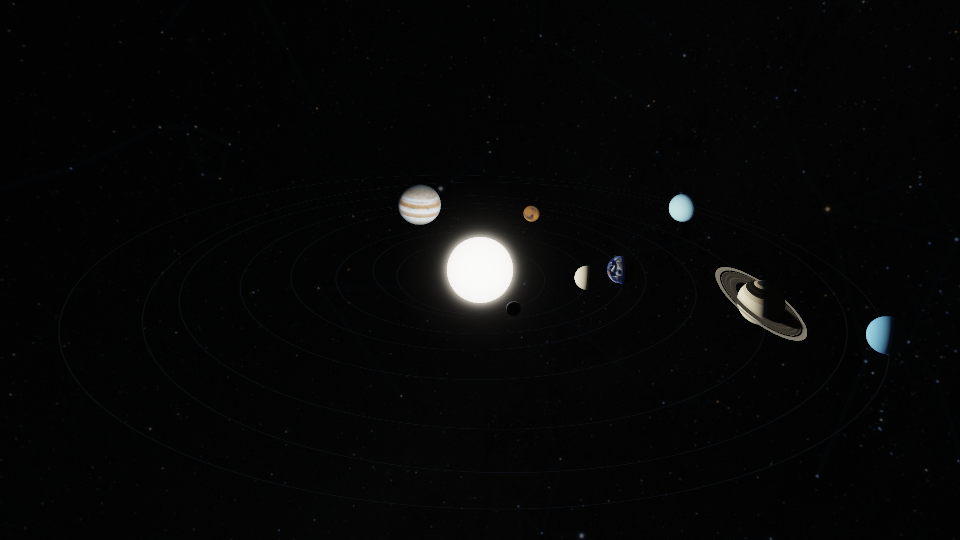
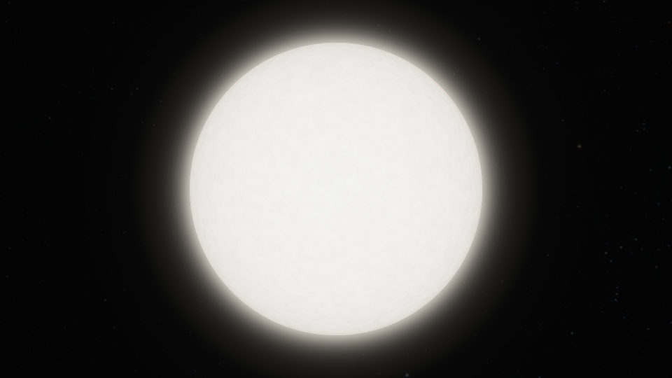
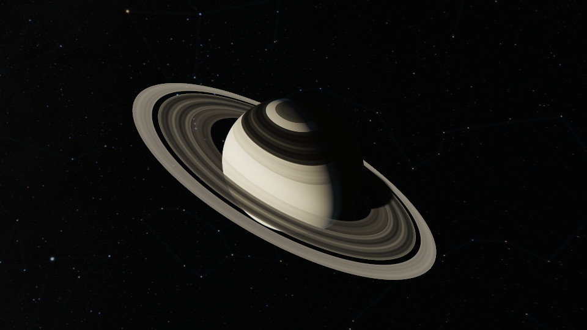

# Interactive Solar System wallpaper

**Wallpaper → Solar System 3D** is available on the X11 compositor (xcb and
x11rb). Open the native picker with `Alt+Ctrl+W`; select all screens, a connector
or a shared group and choose the Solar System scene. The common configuration
is `wallpaper_effect = "astronomy"` with
`wallpaper_astronomy_scene = "solar-system"`; the earlier
`wallpaper_effect = "solar-system"` value remains supported. Span, Mirror and
Independent layouts can combine a Solar System screen with other celestial
themes. See the [multi-display guide](astronomy-wallpaper.md#display-layouts).
Native Wayland retains the existing static fallback. Selecting a static image
with **Apply to: All screens** restores ordinary wallpaper behavior.

The [celestial explorer guide](celestial-explorer.md) covers the shared body,
galaxy and Solar System controls. All gestures start on uncovered wallpaper with
no modifier key. Windows, bars, tabs, modal panels, the lock screen and configured
mouse bindings keep their normal priority.

## 实际渲染预览

以下为生产着色器在 **Mesa llvmpipe（LLVM 20.1.2）** 下输出的
**960×540 原始 PNG**，未经修图。图中展示 GL330 路径的结果；同一份源码的
GL330 与 GLES300 路径均通过 `smoke` 验证。这些是软件渲染预览，不是摄影图，
也不是目标显卡的性能实测。源码、贴图和图片哈希及验证结果见
[精简验证记录](images/solar-realism-validation.json)。

**太阳系总览**：相机呈现前后层次，显示距离与天体大小仍经过压缩。

**太阳近景**：近白光球、临边明暗与独立增强曝光的日缘辉光。

**土星近景**：扁球轮廓、薄环分层、透射与星球和环之间的阴影。

## Explore the system and individual bodies

| Gesture | Result |
| --- | --- |
| Left-click the Sun or any of the eight planets | Open an isolated close-up that follows that body along its orbit |
| Left-drag a visible body in the overview | Orbit the whole system in any direction, including roll and passage through either pole |
| Left-drag a visible body in a close-up | Orbit the focused body in any direction |
| Left-drag empty sky | Turn the camera's viewing direction through the full celestial sphere |
| Wheel in the overview, or over empty sky in a close-up | Narrow or widen the perspective lens |
| Wheel over the focused body's visible surface | Move the camera closer to or farther from that body |
| Right-click any uncovered wallpaper in a close-up | Restore the saved overview camera, orientation and lens |

Saturn's visible rings select Saturn. Picking uses the nearest displayed body
or visible ring, including occlusion by foreground objects. The four giant
planets use the same tilted oblate shape in rendering and CPU picking. A click
opens the body only when the left button is naturally released and the pointer never
travels more than four pixels from its initial position. A drag that moves out
and back remains a drag. Clicking empty sky does not select a body. There is no
global Escape binding; application key handling stays intact.

Both body and sky gestures capture the pointer and retain the projection visible
at the initial press. They can continue across windows and onto another output
without retargeting or changing sensitivity. Release includes the final event
position. Pointer loss, modal capture, locking, removed/resized outputs and an
unavailable renderer cancel the gesture without opening a body. Wheel events
during a held drag do not change its reference geometry.

Body dragging uses the same rigid quaternion trackball as Earth and Moon, so
the new interaction has no elevation clamp. Empty-sky dragging changes the view
from the current camera position: planets and distant stars move coherently
through the same perspective. It can point away from the focused planet; drag
back, or right-click the wallpaper to return to the saved overview. Right-click
also works when a close-up fills the canvas with a planet.

The shared panorama lens control defaults to 60° and is bounded to 8°–110°.
Solar applies its tangent ratio to the existing aspect-aware focal length, so
these control values are not the exact vertical field of view for every screen
shape. Close-up surface scrolling instead changes distance, bounded between
1.12 and 40 times the focused body's displayed radius, keeping the camera
outside its bounding sphere. A fresh selection frames the illuminated
hemisphere obliquely and gives Saturn extra room for its rings. Close-up navigation tracks orbital position;
it does not freeze the body's rotation or move the Sun.

Camera poses, lens, current selection and the saved overview last only in the
running session. They are not written to configuration. Independent connectors
have separate cameras; a named shared group or Mirror copies share one view.
Scene selection, display layout, grouping and the clock configuration are saved
by the native picker. No extra setting enables the mouse controls.

## Scene and surface detail

The default `wallpaper_solar_orbit_mode = "ephemeris"` computes date-driven
positions from JPL's approximate planetary elements, including elliptical
motion and inclination. Each orbit is rescaled independently and the bodies
are enlarged for readable navigation: the display is not to scale, and its
apparent alignments are not predictions of real transits. The optional
`"illustrative"` orbit mode retains the decorative tour. The
[scientific model notes](astronomy-science.md) describe the fitted date range,
UTC conversion, independent reference checks and accuracy limits.

Perspective, body occlusion, sun-facing lighting and Saturn's ring depth are
computed in 3D. The close-up retains the focused body, material, illumination
and rings while hiding the other bodies and orbit guides. Earth uses the
bundled NASA October surface and historical MODIS cloud composite. Mercury,
Mars and Jupiter load the installed historical MESSENGER, Viking/USGS and
Cassini map products; their limitations remain visible in the picker's About
notes. The Mercury map is a shaded monochrome mosaic rather than an albedo map,
and Jupiter's clouds describe a historical observation, not current weather.
The sky uses the shared 4K NASA full-star atlas, with faint constellation figures
and four procedural nebula landmarks. Its directions remain attached to a distant
celestial sphere as the camera turns. This provides a foundation for spatial
exploration; free interstellar translation, volumetric nebula flight and
gravitational N-body dynamics are not implemented. Source data and derivations
are recorded in the [asset attribution](../assets/astronomy/README.md), and the
[explorer guide](celestial-explorer.md#sky-catalogue-and-nebulae) separates sourced
directions from artistic nebula shapes.

Earth and its cloud image initially load off-thread at no more than 2048×1024.
Entering an Earth close-up requests the surface at up to its native 5400×2700,
bounded by the GPU texture limit. The base map remains visible until additional
detail is ready; a failed detail load keeps that base. The sky atlas retains up
to 4096×2048 where supported. Successful loads are adopted only on a new full
material frame, preserving scissored repairs. Missing/invalid optional imagery
falls back independently to procedural materials. The old sky JPEG remains a
compatibility fallback.

The sky's RGB catalogue and constellation data share one RGBA lookup per visible
background pixel, with sRGB decoding before the Solar tone mapper. Figures are
subtle in wide views and fade further at close magnification. Nebula colours,
shapes and apparent sizes are original artwork around sourced directions; they
are not telescope images or measured volumes of gas. Earth cloud luminance is a
visual opacity mask on a separate shell, using the same body-fixed coordinates
as its surface. Bodies without installed observation-based maps use labelled
approximations. Venus
has an opaque pale cloud deck; Saturn, Uranus and Neptune use approximate
visible appearances, not measured dynamic atmospheres. In Scientific
presentation, unavailable mapped terrain is not replaced with invented crater
geography or named storms. Illustrative presentation permits filtered,
body-attached grain, crater-like patterns and cloud bands. Those extra layers
fade when their features become smaller than a pixel, reducing shimmer while
zooming or orbiting. They do not turn a colour map into a measured height field
or a terrain mesh.

Image materials use mipmaps and trilinear minification, with analytic texture
gradients that remain stable at longitude seams and near the poles. This reduces
moiré and flickering when detailed maps shrink onto a distant planet. Mipmaps
are generated once when the material is adopted and add approximately one-third
to its texture storage. A failed mipmap generation keeps the base image and
falls back to linear sampling. The full-resolution scene cache is unchanged.

### Visible-light rendering

Jupiter, Saturn, Uranus and Neptune use NASA reference polar/equatorial radius
ratios for their tilted oblate silhouettes, illumination normals and picking.
The flattening is not exaggerated; the display sizes and orbital distances
remain compressed. The [science notes](astronomy-science.md#visible-light-geometry-and-lighting)
list the reference dimensions and the limits of this model.

The Sun has a near-white photosphere, limb darkening and analytic granulation
filtered to the pixel footprint. Its separately enhanced, pale limb glow is a
display layer, not measured coronal brightness or a reconstruction of current
solar activity. Saturn's thin rings have radial optical-depth bands, filtered
ringlets, viewing-angle-dependent transmission and mutual shadows with the
oblate planet. Reflected and transmitted light differ between the illuminated
and opposite faces of the rings.

Earth's independent cloud shell adds parallax and approximate cloud shadows.
A blue-colour heuristic from the existing surface image limits rough ocean
specular reflection (GGX); it is not a measured water, wave or roughness map.
The nearest visible atmosphere uses at most six integration samples with
altitude falloff and sunlight occlusion. Its colour and density are display
approximations, not a spectral or multiple-scattering atmospheric solution.

These analytic optical layers are also present in Scientific presentation.
Observed maps still take priority, and missing observations do not acquire
invented geographic features, sunspots or named storms. Image colours are
decoded once; lighting, clouds, rings and atmospheres are combined in linear
light before one final filmic tone map and display transfer. The Sun, planets
and surrounding sky use separate display exposure factors. Their simultaneous
visibility is not a prediction of one camera exposure. This update requires
no additional images or runtime downloads.

## Rotation and time

Each planet rotates independently as a rigid body around its own tilted axis.
Sidereal spin periods and obliquities follow the
[NASA GSFC planetary fact sheets](https://nssdc.gsfc.nasa.gov/planetary/factsheet/).
Venus and Uranus rotate retrograde; their full obliquities encode that direction
once. Saturn’s rings share its equatorial plane. Surface patterns, Earth’s map,
clouds and storms stay attached to each body, while sunlight and shadows remain
in the world frame. Axis azimuths and starting surface longitudes remain
presentation choices, not an IAU pole/prime-meridian solution for the orbital
date. The date-derived orbital centres do not make those surface phases a
geographic prediction.

`behavior.wallpaper_solar_spin_speed` controls only these eight self-rotations:

- `718.035` (default): Earth completes a sidereal turn in 120 displayed seconds.
- `1.0`: real-time sidereal rotation; Earth takes 23.9345 hours, not the 24-hour solar day.
- `0.0`: pause planetary self-rotation without changing the orbital clock.

The finite range is 0 through 10000. Every planet uses the same time multiplier,
so Mercury and Venus visibly turn much more slowly than the gas giants. Changing
speed preserves the current surface longitude. Spin pauses while the effect is
inactive, fully covered or unpowered and resumes from its held phase. Restarting
the application resets presentation phases. The independent
`wallpaper_solar_time_scale` defaults to `1.0`, following current UTC plus
`wallpaper_solar_time_offset_days`. The native picker offers Now, Pause,
1×, one day per second and ±day/month date offsets. The global orbital clock
updates all Solar System scenes together while their cameras remain independent.
Activating a **Global date-derived clock** row also selects Ephemeris mode;
the decorative tour does not consume calendar-date settings.
Its implemented playback interval is 1972-01-01 through 2049-12-31 23:58 UTC,
clamped at either endpoint. The [orbital-clock guide](astronomy-wallpaper.md#solar-orbital-clock)
specifies offset bounds, pause/restart behavior and the exact meaning of 1×.

The default spin multiplier is accelerated even when the orbital date runs at
1×; set both multipliers to `1.0` for reference-period spin and real-time
orbital playback. These controls never alter Astronomy Earth/Moon's own
rotation settings. Those gallery scenes derive Earth's daylight and the
Moon's phase from the actual UTC instant, and neither zooming nor turning
their cameras adds a timezone offset.

## Rendering cost and validation

The wallpaper uses analytic body/ring intersections and at most six integration
samples through the nearest visible atmosphere, never unbounded ray marching.
Body silhouettes and visible rings receive four subpixel rays; filtered
interiors and smooth sky use one shading ray, and soft orbit guides have
analytic coverage. Both presentations include the optical layers described
above; Scientific presentation retains restrained materials and night-side fill.
Idle animation is capped at 15 frames
per second and pauses when fully covered or displays are asleep. Pointer-driven
camera and lens updates have a separate coalesced 60 Hz rendering cap and
invalidate the matching backdrop. Holding still does not keep the fast rendering
deadline active; the pointer watchdog continues to protect the grab. Native
left-button motion samples are retained to classify clicks correctly and are
processed in bounded batches, so high polling rates still affect CPU input work.
Power state is checked at the existing two-second interval.
Failure to compile the material retains the static fallback and stops animation
wakes until the effect is changed.

Run `python3 scripts/test-solar-system-shader.py --profile smoke --width 640 --height 360`
for a bounded regression gate on surfaceless Mesa GL330 and GLES300. It checks
the production camera and CPU/GPU picking, finite HDR output, solar and ring
optical behaviour, foreground solar occlusion, world-space illumination,
independent outputs and scissored repair. Close-up, grazing-ring and backlit
views are included. For image iteration without that diagnostic matrix, use
`python3 scripts/test-solar-system-shader.py --profile preview --api gl330`.
Preview still checks basic rendering, camera and canvas invariants; it is not
a substitute for the regression gate. Neither short profile records benchmark
timings.

The default `--profile full` retains the complete regression matrix. It uses
production Rust camera and phase helpers, verifies actual close-up cameras for the Sun and every planet,
CPU/GPU picking agreement, full-axis views, panorama lens limits, filtered
surface detail, orbital/surface wrap continuity, ring/Sun alignment and
scissored repair. PNGs and metrics are saved under `/tmp/jwm-solar-preview`.
`--output` selects another destination, `--asset-dir` selects an existing local
texture directory, and `--width`/`--height` set the image dimensions. Assets are
read locally; the harness does not fetch textures.
Set `SOLAR_SPIN_VIDEO=1` for a fixed-camera, fixed-orbit self-rotation preview
(three displayed seconds per saved frame), or `PREVIEW_WIDTH=540 PREVIEW_HEIGHT=960` for portrait coverage, or `SOLAR_VIDEO=1`
to write ninety orbit/zoom preview frames. `SOLAR_NO_EARTH=1`, `SOLAR_NO_CLOUD=1`, and `SOLAR_NO_SKY=1` independently verify
optional-image fallbacks. The saved `focus-*` and `near-*` images use the real
close-up cameras. The additional `material-closeups` sheet places the production
material functions on diagnostic spheres for comparison. `SOLAR_BENCH_ONLY=1`
records six synchronized full-frame draw timings;
`SOLAR_BENCH_NEAR=1` selects the close camera benchmark. Software Mesa results
are not hardware frame-rate claims. A dedicated GitHub workflow runs the
landscape and portrait regressions.
